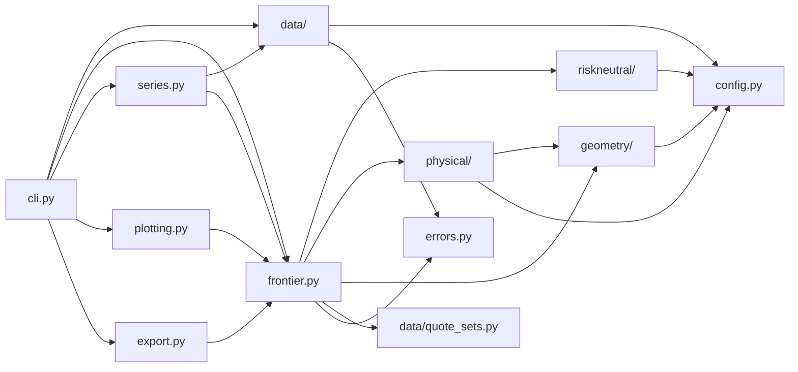
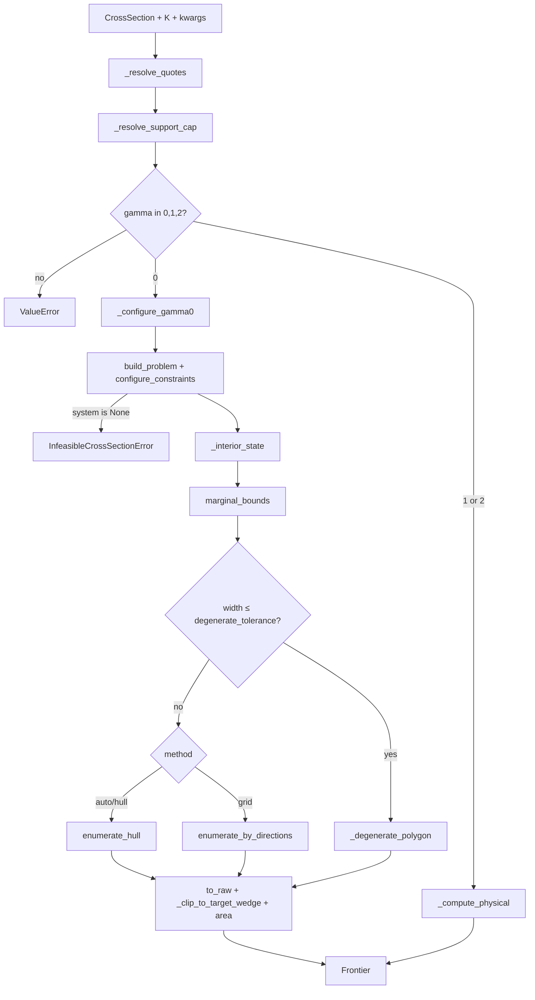
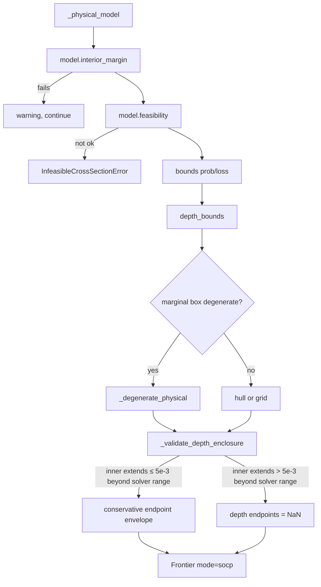
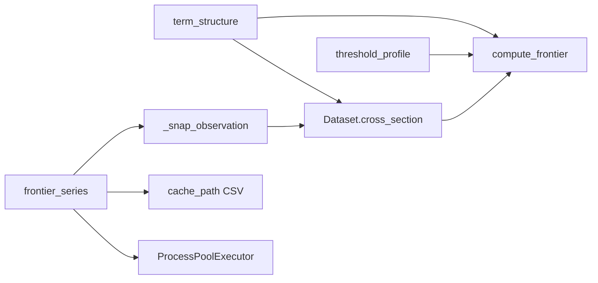

# Module dependencies and call chains

## Package layout

```text
crashfrontier/
  __init__.py          public API re-exports
  config.py            LPSettings, GridSettings, defaults, COLORS/LABELS
  errors.py            exception tree
  frontier.py          Frontier and computation façade
  series.py            tenors / thresholds / time series
  plotting.py          figures
  export.py            CSV/JSON
  cli.py               subcommands (matplotlib backend Agg)
  data/                readers, canonical schema, cross-sections, quote sets
  geometry/            polygons, depth map, hull/grid, unit box
  riskneutral/         γ=0 LP and duals
  physical/            γ=1/2 SOCP, cones, rescue solve
```

`config.py` re-exports `ConicSettings` from `physical/solve.py`. The root
`__init__.py` does not export `Dataset.from_spec`, data internals other than
`QuoteFilter`, or `Gamma1Model` / `Gamma2Model`; those live in submodule
`__all__`.

## Dependency direction



Rules:

- `data/` does not depend on solvers or geometry.
- `riskneutral/` does not depend on `physical/` or on `frontier.py`.
- `physical/gamma1.py` borrows only the `ConicPoint` dataclass from
  `physical/gamma2.py`.
- `geometry/` depends on numpy/scipy/pandas and itself. The `hull`/`grid`
  oracle signature is `(unit_direction) -> (point, support)`; it does not know
  LP from SOCP.
- `frontier.py` is the only place that assembles quote sets, programs,
  reconstruction, area, and depth into a `Frontier`.

## Public API and internal entry points

Root exports (`crashfrontier/__init__.py`):

`Dataset`, `CrossSection`, `QuoteFilter`, `ColumnMap`, `Frontier`,
`compute_frontier`, `nested_frontiers`, `scenario_check`, `portfolio_bound`,
`binding_quotes`, `term_structure`, `threshold_profile`, `frontier_series`,
every `plot_*`, `save_figure`, `write_frontier`, `LPSettings`, `ConicSettings`,
`GridSettings`, `__version__`.

Common development entry points that are **not** in the root `__all__`:

| Symbol | Module |
|---|---|
| `build_problem`, `configure_constraints`, `support` | `riskneutral/lp.py` |
| `dual_certificate`, `interior_margin` | `riskneutral/certificates.py` |
| `Gamma1Model`, `Gamma2Model`, `solve_with_rescue` | `physical/` |
| `enumerate_hull`, `enumerate_by_directions` | `geometry/hull.py`, `geometry/grid.py` |
| `select_quote_set` | `data/quote_sets.py` |
| `build_cross_section` | `data/cross_section.py` |

## Single cross-section: `compute_frontier`



Key functions:

1. `_resolve_quotes`: a `DataFrame` `quote_set` is used as-is under the name
   `"custom"`. Otherwise `select_quote_set(cs.quotes, K, name, design)`. When
   `quote_set is None`, γ=0 uses `put_wing` and γ>0 uses `full_otm`. When
   `design is None`, γ=0 → `"riskneutral"`, otherwise `"physical"`.
2. `_resolve_support_cap`: `None` stays unbounded; the string `"auto"` branches
   on γ; `"none"` / `"null"` / `"unbounded"` or a non-finite float → `None`.
3. γ=0: `_configure_gamma0` wraps `build_problem` and
   `configure_constraints`.
   `mode="auto"` tries hard first, then relaxed (budget `budget` or
   $\delta^\star+10^{-10}$) and logs a warning. A finite `support_cap` calls
   `impose_support_cap`.
4. Reconstruction is in **unit-box** coordinates, default
   `BoxNormalizer(lo, hi-lo)`. The oracle is `_SupportOracle` (LP,
   `lexicographic=True`, support value `upper_value`) or `_PhysicalOracle`
   (SOCP, support value `value`).
5. After mapping back, both inner and outer polygons are passed through
   `_clip_to_target_wedge` ($p\in[0,1]$, $L\ge 0$, $L\le Kp$). An empty
   intersection remains empty.
6. Area is `transformed_area(..., p0)`, not shoelace area. See
   [depth-transform.md](depth-transform.md).

`method="auto"`: in **source**, γ=0 forces `"hull"` and γ>0 forces `"grid"`.
Do not write that both default to hull.

## Physical branch: `_compute_physical`



- The `mode` field is always `"socp"`; there is no hard/relaxed pair.
- `model.depth_bounds()` supplies the solver endpoints. If numerically
  resolved inner vertices extend outside that interval by at most `5e-3`,
  the public interval conservatively expands to include them. An extension
  beyond `5e-3` writes NaN and sets
  `diagnostics["depth_enclosure_ok"] = False`; the joint set is still
  returned. A wider solver interval containing the inner range remains
  valid regardless of `depth_endpoint_gap`.
- The infeasibility hint `_INFEASIBLE_HINT` is appended only for γ>0.

## Nested sets: `nested_frontiers`

Default collection `_nested_names`:

- γ=0: `put_pair`, `local_eight`, `put_wing`
- γ>0: those plus `full_otm`

`accumulate_halfplanes` defaults to True for γ>0 and False for γ=0. When True,
layer $k$’s inner and outer polygons are intersected with all half-planes
accumulated up to that layer (`_apply_accumulated_halfplanes`). The
`halfplanes` field is replaced by the accumulated set, and both transformed
areas and `area_ratio` are recomputed.

γ=0 and `mode="auto"`: `configure_constraints` runs first on the **largest set**.
If it falls back to relaxed, every layer shares that `mode`, that `budget`
(largest-set $\delta^\star+10^{-10}$ unless the caller passed `budget`), and
that `full_strike_count` (distinct strikes on the largest set). Test:
`test_nested_frontiers_share_relaxed_budget`.

γ>0 unit box: the first non-degenerate `put_pair` (if present) supplies a
shared `BoxNormalizer`. A later layer that raises `SolverFailure` under the
shared box, when the caller did not pass `normalizer`, retries once without
the shared box (warning `_SHARED_NORMALIZER_RETRY_WARNING`). An
`InfeasibleCrossSectionError` on one layer **does not omit that layer**; it
re-raises naming the completed layers.

## Scenarios, portfolios, certificates

| Function | γ | Behaviour |
|---|---|---|
| `scenario_check` | 0/1/2 | `compute_frontier` then `Frontier.contains`. `inside` → feasible; `outside` → infeasible; `boundary` solves once more (`scenario_feasible` or `model.scenario_feasible`) |
| `portfolio_bound` | 0 only | `(-h(-u), h(u))` using `SupportResult.value`, not `upper_value` |
| `binding_quotes` | 0 only | `support(..., lexicographic=False)` in the given direction plus `dual_certificate`. Hard infeasible → relaxed + warning |

γ≠0 on the last two functions raises `ValueError`.

## Batch entry points



Failure isolation: `term_structure` / `threshold_profile` /
`frontier_series(..., on_error="skip")` catch `CrashFrontierError` and
`ValueError` (including `SolverFailure`, `InfeasibleCrossSectionError`,
`NoEligibleExpiryError`), write an `error` column, and continue. Details:
[series-parallel.md](series-parallel.md).

## Exception tree

`errors.py`:

```text
CrashFrontierError
  SchemaError
  NoSuchDateError
  NoEligibleExpiryError
  MissingForwardError
  InfeasibleCrossSectionError   carries date/expiry/quote_set/gamma/support_cap/status
  SolverFailure                 LP/SOCP did not return a usable solution
```

The CLI (`cli.py`) catches `CrashFrontierError`, `ValueError`, `OSError`,
prints one `error: ...` line to stderr, and exits 1. Tracebacks print only
with `--log-level DEBUG`.

## Settings objects

`LPSettings` (`config.py`): HiGHS feasibility $10^{-10}$, time limit 5s, hull
edge tolerance $10^{-8}$, point tolerance $10^{-9}$, degeneracy $10^{-10}$, at
most 500 support calls in hard mode, 160 anytime calls in relaxed mode, area
relative tolerance $0.002$, interior cutoff $10^{-8}$, validation multiplier 5.

`GridSettings`: direction counts `(32, 64, 128)`, unit-box
`max_normalized_gap=0.01`.

`ConicSettings` (`physical/solve.py`): primary solver `CLARABEL`, fallbacks
`("ECOS", "SCS")`, cone tolerance $10^{-9}$, violation $10^{-6}$, objective
consistency $10^{-7}$, `warm_start=True`.

## CLI versus library

- Only `cli.py` calls `matplotlib.use("Agg")`. Library plotters accept `ax`
  and return a `Figure`.
- Only the CLI writes to stdout; the library uses
  `logging.getLogger("crashfrontier")`.
- `--cache` is a date-index directory; `series --resume` is
  `frontier_series(cache_path=...)`. Do not point both at the same path.
- `--quote-set` and `--nested` are mutually exclusive (`tests/test_cli.py`).
