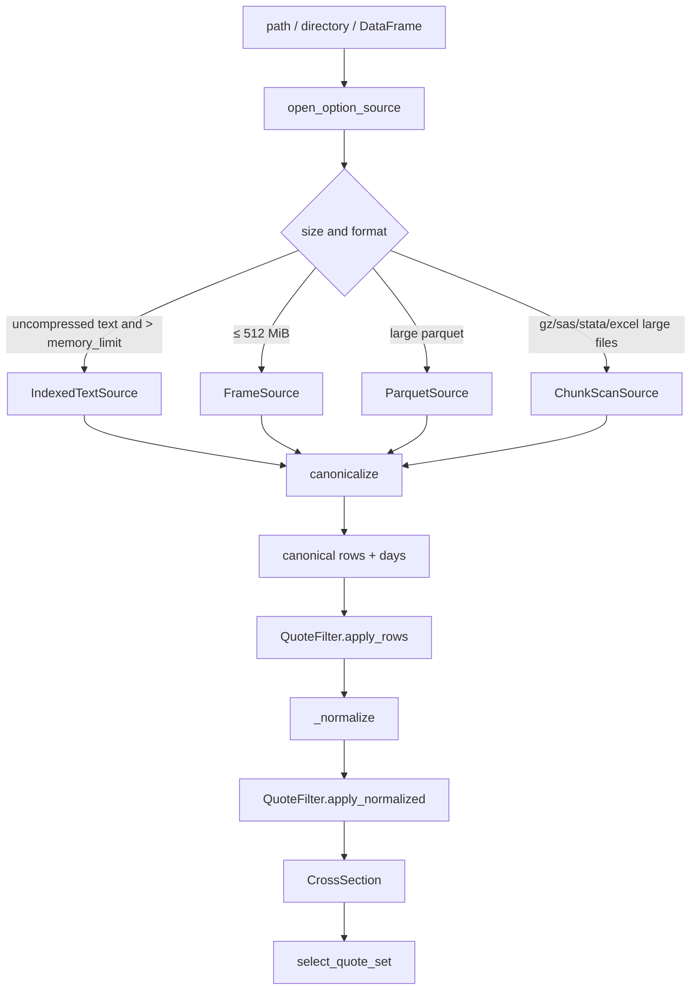

# Data pipeline, canonical schema, and CrossSection invariants

The data layer reduces arbitrary OptionMetrics-style input to two tables:
**canonical option rows** and **CrossSection.quotes**. Solvers see only the
latter.

## Pipeline



Entry points: `Dataset.__init__` / `Dataset.from_directory` /
`Dataset.from_frames` / `CrossSection.from_quotes`. `from_directory` scans
only `root` and optional `root/RAW_DATA` **one level**; it does not recurse.

## Canonical option rows

`canonicalize` (`data/schema.py`) output column order =
`CANONICAL_FIELDS + ("days",)`:

| Column | Required | Rule |
|---|---|---|
| `date`, `expiry` | yes | `parse_dates` then `normalize` to midnight |
| `cp_flag` | yes | `"C"` / `"P"` |
| `strike` | yes | already divided by `strike_scale`, same units as the underlying |
| `bid`, `ask` | yes | `parse_numeric` |
| `volume`, `open_interest`, `impl_volatility`, `forward_price` | no | missing column → all NaN |
| `quote_id` | no | missing → `r{row}`; integer ids become int then str, avoiding `"83164582.0"` |
| `am_settlement` | no | see settlement parse |
| `symbol` | no | missing → `""` |
| `root` | no | if `symbol` is present, first token before a space; else the `root` column; else `""` |
| `expiry_indicator` | no | missing → `""` |
| `days` | derived | `(expiry - date).days`, integer |

Rows missing `date`/`expiry`/`strike`/`bid`/`ask`/`cp_flag` are dropped; the
count is logged at `logger.debug`.

### Column map

`ColumnMap.detect`: names first go through `normalize_name` (strip BOM/quotes,
lower-case, space/`-`/`.` → `_`). Each canonical field is matched in
`ALIASES` order. Short aliases `type`, `flag`, `id`, `k` are used **only
after every long alias has missed**. One raw column cannot be assigned to two
fields; the later match is treated as missing. `overrides` win. A missing
required field → `SchemaError`, message includes aliases and actual column
names.

`ColumnMap.optionmetrics()` pins standard OptionMetrics names: `exdate`,
`strike_price`, `best_bid`, `best_offer`, `optionid`, `am_settlement` (not
`am_set_flag`).

### Value parse (`data/parse.py`)

- **Dates**: already datetime → drop tz and normalize. Numeric: 8-digit
  `YYYYMMDD`; `[5000,30000]` as SAS days (origin 1960-01-01); `[30000,80000]`
  as Excel serial (origin 1899-12-30). Strings try a format table; when both
  `%m/%d/%Y` and `%d/%m/%Y` succeed: honour `dayfirst` if it is not None,
  otherwise inspect whether the first/second token exceeds 12; if still
  undecided, month-first plus a warning.
- **Numeric**: strip `,` and `$`; SAS `"."` → NaN.
- **C/P**: first character C/P, or a `cp_values` lookup table.
- **Settlement**: nonzero numeric → 1. Strings `AM`/`A`/`1`/`TRUE`/`Y` → 1;
  `PM`/`P`/`0`/`FALSE`/`N` → 0. Missing column and `(root == "SPX")`: monthly
  SPX is AM=1; `SPXW` and empty root are 0.
- **Strike scale**: candidates `(1,10,100,1000)`. With a reference price,
  minimise $|\log(\mathrm{median}(strike)/s / F_{\mathrm{ref}})|$. Without:
  median > 1e5 → 1000, else 1, plus a warning. `Dataset` reference-price
  chain: median of that date on the forward table → median of the
  `forward_price` column → spot → NaN. Cached on the first
  `option_rows`/`_ensure_meta`.

## File sources

`open_option_source` (`data/source.py`):

| Condition | Implementation | Behaviour |
|---|---|---|
| `DataFrame` | `FrameSource` | in-memory filter; `spec()` raises `ValueError` |
| uncompressed text and total size > `memory_limit` (default 512 MiB) | `IndexedTextSource` | byte-offset index |
| total size ≤ limit | `FrameSource` | load the whole table (including small parquet/gz/sas/stata/excel) |
| parquet and total size > limit | `ParquetSource` | filters by every source timestamp that normalizes to the requested calendar date |
| other large files | `ChunkScanSource` | full-file chunk scan each time; constructor logs a warning recommending conversion to uncompressed CSV |

Default index directory:
`paths[0].resolve().parent.parent / "CACHE"`, i.e. `CACHE/` two levels above
the first option file, not the file's own directory. For example,
`/market/RAW_DATA/options.csv` maps to `/market/CACHE`. Override with
`Dataset(cache_dir=...)`.

`build_date_index` (`data/index.py`) is the only path allowed to scan a giant
CSV sequentially in full: record each raw date string’s `[start,end)` byte
interval and write JSON. A file opened alone is cached as
`{stem}.index.json`. When one dataset opens several files that share a
stem, each name gains a 12-character hash of the resolved path
(`{stem}-{hash}.index.json`). On load, the stored `source` must match that
path. The index is rebuilt when `source`, `size`, `mtime`, `date_column`,
or the delimiter disagree.
Fields before the date column must not contain a quoted delimiter.

The date-list cache uses the same file names with suffix `dates.json`.
For `options.csv.gz` the stem is `options.csv`. The payload records
`source`, `size`, `mtime`, and `dayfirst`. A different `dayfirst`, or a
stored source that does not match the file being opened, misses and the
dates are scanned again.

Missing optional format engines raise `ImportError` with an install hint.
Parquet asks for `crashfrontier[parquet]` (`pyarrow`). `.xlsx` and `.xlsm`
ask for `crashfrontier[excel]` (`openpyxl`). `.xls` asks for `xlrd`, and
`.xlsb` asks for `pyxlsb`.

## Directory auto-classification

`classify_table` looks at headers only:

1. Hits strike, cp_flag, and bid aliases together → `"options"` (several
   allowed; all are used)
2. Hits forward aliases and expiry aliases, and does not hit strike →
   `"forwards"`
3. Contains `days` and hits a rate alias → `"zero_curve"`
4. Exactly two columns, one a date, the other starting with `dgs` or hitting
   `rate/yield/tbill/riskfree/rf/value` → `"rate_series"`
5. Date + price aliases → `"spot"`
6. Else → `"unknown"` (ignored, `info`)

`from_directory`: more than one forwards / zero_curve / rate_series →
`SchemaError`. Spot filenames containing `vix` or `vx` are dropped even
when that file is the only spot candidate. If more than one spot file
remains, prefer names containing `spx`/`spot`/`secprd`/`underlying`/`index`;
still multiple → `SchemaError`.

## Forwards, rates, spot

Default forward chain `("table", "column", "parity")`; `resolve_forward`
takes the first finite value. `CrossSection.forward_source` is
`table` | `column` | `parity` | `user`.

- `ForwardTable`: key `(date, expiry)`. Several rows and `am` given → match
  settlement; still several or `am is None` → `_pm_or_first` (prefer
  `am_settlement==0`, i.e. PM).
- `ForwardColumn`: median of the option-file `forward_price` column by
  `(expiry, am_settlement)`. The observation date is ignored.
- `ParityForward`: strikes with a compliant C and P,
  $F_\kappa=\kappa+(C_{\mathrm{mid}}-P_{\mathrm{mid}})/D$; reference is
  finite spot else the median of $F_\kappa$; take the median of at most 9
  closest $|\kappa-\mathrm{ref}|$ (return `None` if fewer than 2).

Rates: $D=\exp(-r\cdot\mathrm{days}/365)$. `SeriesRate` percentages default
to `/100`, forward-filled by date, last observation `≤ date`. `ZeroCurveRate`
linearly interpolates in days and extrapolates at the ends. `None` →
`ZeroRate` (warning on first use). Dates earlier than any coverage raise
`ValueError`.

Spot is only a parity reference and `CrossSection.spot`; NaN is allowed.

## QuoteFilter

`data/filters.py`. Defaults: `min_volume=1`, `min_open_interest=0`, positive
strikes, nonnegative bid, positive ask, uncrossed, `days∈[7,120]`,
`require_finite=True`, `min_width=0`, `one_quote_per_strike=False`.

`apply_rows` and `apply_normalized` drop rows in rule order and count.
If the `volume` column is entirely missing, the volume rule is skipped and
`filter_report["volume_unavailable"]=1`. `QuoteFilter.permissive()` only sets
`min_volume` to 0.

`one_quote_per_strike=True`: keep the narrowest normalised interval at each
`(cp_flag, strike)` (stable sort by `quote_id`).

`filter_report` keys: row-level rules + normalised rules +
`volume_unavailable` + `kept`. `kept` is the post-normalisation count.

## CrossSection invariants

`data/cross_section.py`. `frozen` dataclass. Fields: `date`, `expiry`,
`am_settlement`, `root`, `days`, `tau`, `forward`, `forward_source`, `rate`,
`rate_source`, `discount`, `spot`, `quotes`, `filter_report`,
`ambiguous_settlement` (default False).

$$
\tau=\mathrm{days}/365,\qquad D=\exp(-r\tau)
$$

`quotes` column order is fixed as `QUOTE_COLUMNS`:

```text
quote_id symbol root cp_flag strike bid ask volume open_interest impl_volatility
x log_moneyness norm_bid norm_ask norm_l norm_u role
```

Normalisation (`_normalize`):

$$
x=\frac{\kappa}{F},\quad
\texttt{norm\_bid}=\frac{\mathrm{bid}}{DF},\quad
\texttt{norm\_ask}=\frac{\mathrm{ask}}{DF}
$$

- Call: `norm_l=norm_bid`, `norm_u=norm_ask`
- Put: `norm_l=\mathrm{norm\_bid}+1-x`, `norm_u=\mathrm{norm\_ask}+1-x`
- `log_moneyness=\log x` (NaN if $x\le 0$)
- `role`: put and $x\le 1$ → `otm_put`; call and $x\ge 1$ → `otm_call`; else
  `itm`. ATM puts/calls count as OTM
  (`tests/test_cross_section.py::test_role_atm_and_itm`).

Invariants (locked by tests):

1. Column order and a stable sort by `strike, cp_flag, quote_id`.
2. When bid=ask, put-parity intervals at a strike coincide with the call
   intervals.
3. `root`: unique value of canonical-row `root`; more than one → `"MIXED"`.
4. AM/PM **must not be merged**. `expiries` splits on
   `(expiry, am_settlement, root)`. If `cross_section` is called without a
   settlement and the same expiry has AM and PM, pick by `n_put_strikes`
   descending then `am_settlement` ascending (tie → `am_settlement=0`, i.e.
   PM), set `ambiguous_settlement=True`, and warn.
   `test_ambiguous_settlement_does_not_mix_am_pm`.
5. `from_quotes` and `build_cross_section` / `Dataset.cross_section` produce
   the same `quotes` on synthetic data (tolerance on the order of $10^{-9}$;
   see `test_dataset.py` variants).

`from_quotes`: at least `strike, cp_flag, bid, ask`. Missing date columns are
filled from arguments. A settlement column is further filtered by the
`am_settlement` argument. `forward_source`/`rate_source` are both `"user"`.

## Expiry selection

`Dataset.cross_section` must be given `expiry` **or** `days` **or**
`target_days`. Candidates: rows in `expiries` with a finite forward and
`min_days≤days≤max_days`, then filtered by `am_settlement`/`root`.

- `expiry`: exact match
- `days`: exact calendar days
- `target_days`: window defaults to the filter’s `[min_days,max_days]`, or
  the caller’s `window`; among `n_put_strikes≥min_put_strikes` take the
  smallest `|days-target|`, earlier expiry on a tie

No candidate → `NoEligibleExpiryError`, message includes that date’s expiry
table. `days` is a calendar difference: early-year AM contracts can have a
Saturday `exdate`, one day past Friday; the forward table uses the same
Saturday key.

`n_put_strikes`: distinct put strikes after row filters with
`log_moneyness∈lm_range`. If the forward is unavailable the row has
`forward=NaN`, `forward_source="none"`, put count 0.

## Quote sets

`data/quote_sets.py`. Input is already CrossSection schema. Multiple rows at
one strike are all kept; each row is one constraint.

| Name | Rule |
|---|---|
| `put_universe` | puts with $\log x\in[-0.35,0.05]$ |
| `otm_put_universe` | puts, $x\le 1$, $\log x\ge-0.35$ |
| `otm_call_universe` | calls with $x\ge 1$ |
| `put_pair` | see below |
| `local_eight` | pair strikes plus the rest nearest $|x-K|$, up to 8 distinct $x$ |
| `put_wing` | by design: RN uses `put_universe`; physical uses `otm_put_universe` |
| `full_otm` | OTM puts ∪ OTM calls |
| `full_panel` | all C/P |

`put_pair`:

1. `below` = largest $x$ with $x\le K$; `above` = smallest $x$ with $x\ge K$
2. If they differ → those two strikes
3. If they coincide (a quote sits at $K$) → that strike plus the remaining
   smallest $|x-K|$
4. If one side is missing → at most two distinct strikes of smallest
   $|x-K|$ (smaller $x$ on a distance tie, `np.lexsort`)
5. Return every put row on those $x$

`nested_quote_sets(design)`:

- `"riskneutral"`: `put_pair`, `local_eight`, `put_wing` (wing = `put_universe`)
- `"physical"`: those plus `full_otm` (wing = `otm_put_universe`)

`select_quote_set` also accepts `full_panel`. **γ=0’s default design has no
`full_otm`**: `select_quote_set(..., "full_otm", "riskneutral")` raises
`ValueError`. To use all OTM at γ=0, pass `design="physical"` or a custom
DataFrame.

## Dataset.spec and multiprocessing

`spec()` serialises paths, the column map, the resolved `strike_scale`, and
the filter. An in-memory option source raises
`ValueError("in-memory option source cannot be serialized")`.
`frontier_series(workers>1)` depends on it; failure falls back to
`workers=1`. See [series-parallel.md](series-parallel.md).

## What not to do while developing

- Do not `pd.read_csv` an entire giant `option_price.csv`. Use the index or
  `Dataset.option_rows(date)`.
- Do not merge AM/PM into one `CrossSection`.
- Do not assume `days` is business days or a 365.25-day year.
- Do not change the `norm_*` formulae inside a solver without also changing
  `test_norm_l_norm_u_formulas` / `test_put_call_parity_matches_when_bid_equals_ask`.
