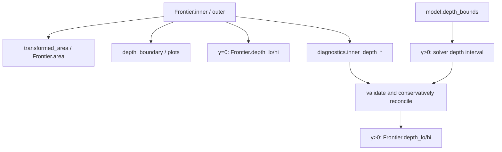

# Depth map: $s=L/p$, $p_0$ clip, and certified endpoints

Depth has three **distinct** computation paths. Mixing them is the most common
integration error.

## The map

For $p>0$:

$$
\phi(p,L)=(p,s),\qquad s=L/p
$$

$|\det D\phi|=1/p$; convexity is not preserved. A non-vertical edge
$L=\alpha+\beta p$ maps to
$s=\beta+\alpha/p$; a vertical edge stays vertical.

Conditional depth lies in $[0,K]$. Total conditional decline from the forward
is $(1-K)+s$.

## Three paths

| Quantity | γ=0 | γ>0 | Uses $p_0$? |
|---|---|---|---|
| `Frontier.depth_lo/hi` | inner-vertex $L/p$ ($p>0$) | conservative envelope of the SOCP endpoints and reconstructed inner-vertex depths | no |
| `diagnostics["inner_depth_*"]` | absent | `_depth_range(inner)` | no |
| `Frontier.area` / `area_outer` | `transformed_area(..., p0)` | same | yes |
| `plot_conditional_depth` | `depth_boundary(..., p0)` | same | yes |
| `vertices()["depth"]` | $L/p$ (NaN if $p>0$ fails) | same | no |

Default $p_0=10^{-4}$ (`DEFAULT_P0`). The floor enters the area
summary only; the frontier itself is defined for every $p>0$.

## Transformed area

`transformed_area(polygon, p0)` in `geometry/depth.py`:

1. `clip_polygon` drops $p<p_0$ (normal $(-1,0)$, upper bound $-p_0$).
2. <3 points → `(nan, nan, nan)`.
3. Breakpoints = unique sorted vertex $p$ coordinates. On each adjacent
   interval $[p_1,p_2]$ ($p_1>0$ and length $>10^{-14}$): take the edges that
   cross the midpoint, split lower/upper boundaries by midpoint $L$ as
   $L=\alpha+\beta p$, and add

$$
(\beta^+-\beta^-)(p_2-p_1)+(\alpha^+-\alpha^-)\log\frac{p_2}{p_1}
$$

4. Also return the min/max of $L/p$ on clipped vertices with $p>0$ (the main
   `Frontier` path uses only the area, not these two).

`test_transformed_area_matches_quad_on_random_triangles`: difference vs
`scipy.integrate.quad` $<10^{-8}$. Rectangles have a closed-form check.

`Frontier._areas`: `area_outer = max(area(inner), area(outer))`; if one side
is NaN, use the other. Degenerate methods force area 0.

Baseline: `marginal_wedge(lo, hi, K, p0)` = the rectangle
$[\max(\ell_p,p_0),h_p]\times[\ell_L,h_L]$ intersected with $0\le L\le Kp$.
`baseline_area` is that wedge’s transformed area.
`area_ratio = area/baseline` (NaN if the baseline is $\le 0$): the
single-cross-section identification gain against the
“marginal box ∩ wedge” baseline.

## Depth-boundary sampling

`depth_boundary(polygon, samples_per_edge=80, p0=0)`: clip at $p\ge p_0$,
lift clipped-vertex $p$ to $\ge p_0$, subsample each edge (right endpoint
excluded), drop $p\le 0$, map $(p,L/p)$, close.
`test_depth_boundary_clips_before_dividing_by_small_probability`.

`Frontier.depth_boundary(samples_per_edge, p_floor=None)` defaults
`p_floor=self.p0`. Plotting uses this path, **not** the certified endpoints.

## γ=0 summary depth

`_depth_range(inner)` defaults to `p0=0`: $L/p$ on every vertex with $p>0$.
No second LP. If every vertex has $p=0$, return NaN. The result is the
conditional-depth ratio on the joint set, evaluated as a
**vertex extremum**, not the global min/max of the exact
$[s^-(p),s^+(p)]$ swept along each horizontal $p=\mathrm{const}$. For a
two-dimensional polygon the vertex extrema are usually the global extrema
($s$ is monotone or $1/p$-shaped on each edge), but they remain an inner
approximation.

## γ>0 certified endpoints

`Gamma1Model.depth_bounds` / `Gamma2Model.depth_bounds`: optimise $s$
directly under $\lambda=1/A_\gamma$. This certifies the conditional-depth
identification interval $\Theta_s$ under the same measure family as the joint
set $\Theta_{q\ell}$, with a different normalisation. The numerical objective is
multiplied by 100 and converted back after solving.

Do not replace it by dividing the $\ell$ interval by the $q$ interval: the
four marginal endpoints generally come from four different measures.

Failure modes (the joint set is still returned):

- `prob_hi < 10^{-4}`
- neither the direct solve nor 40-step bisection certifies
- numerically outside $[-10^{-6}, K+10^{-6}]$ or $\mathrm{lo}>\mathrm{hi}+10^{-8}$

Then `depth_lo/hi` are NaN and `depth_ok=False`. This is a
depth-certification outcome, not cross-section infeasibility; the joint set
is unaffected, so there is no reason to change `quote_set` because of it.

For physical models, inner-vertex ratios use the floor
`max(1e-12, 10 × largest finite recorded solver/oracle violation)`; the
applied cutoff is stored as `inner_depth_probability_floor`.
`_validate_depth_enclosure` then
requires the solver/inner contradiction to be no larger than `5e-3`. Within
that limit the public range is the conservative envelope

$$
\left[
\min(s_{\mathrm{lo}}^{\mathrm{solver}},s_{\min}^{\mathrm{inner}}),
\max(s_{\mathrm{hi}}^{\mathrm{solver}},s_{\max}^{\mathrm{inner}})
\right].
$$

Larger disagreement sets the public endpoints to NaN and records
`depth_enclosure_ok=False`; the joint frontier remains available.

## Visual gap between figures and tables

`plot_conditional_depth`:

- fill `depth_boundary(inner, p0)`
- if outer is materially different from inner, draw a dashed outer image
- vertical upper limit
  $\min($ global max $s\cdot 1.02,\ $ last-layer max $s\cdot 1.28)$; inset
  if the full range exceeds the zoomed range by a factor 1.35
- log horizontal axis: **only when** the displayed interval satisfies
  $\mathrm{upper}/\mathrm{lower}\ge 12$ (percent coordinates,
  `_use_log_probability_axis`). The docstring says “more than one order of
  magnitude”; the implemented threshold is **12, not 10**
- if inner has a vertex with $p<p_0$, a corner note
  `Ratio view: probability ≥ …%`

Therefore: the plotted depth band is $\phi(\mathrm{inner})$ for $p\ge p_0$;
summary `depth_lo/hi` is the certified interval at γ>0 (up to solver
tolerances) and the unclipped ($p_0=0$) vertex ratio at γ=0. They need not
agree.

Time-series `plot_time_series(..., value="depth")` plots the summary columns
`depth_lo/hi` (×100 as percent): certified endpoints or γ=0 vertex depth, not
transformed area.

## Wedge post-processing

`_clip_to_target_wedge` acts on both `inner` and `outer` after reconstruction:

$$
p\ge 0,\ p\le 1,\ L\ge 0,\ L\le Kp
$$

An empty intersection remains empty. Physical tests assert that the returned
polygons satisfy these inequalities (tolerance $10^{-10}$).

γ=0 `depth_lo/hi` can approach $K$ or become numerically large when some inner
vertex has tiny $p$; that is not a certification failure.
