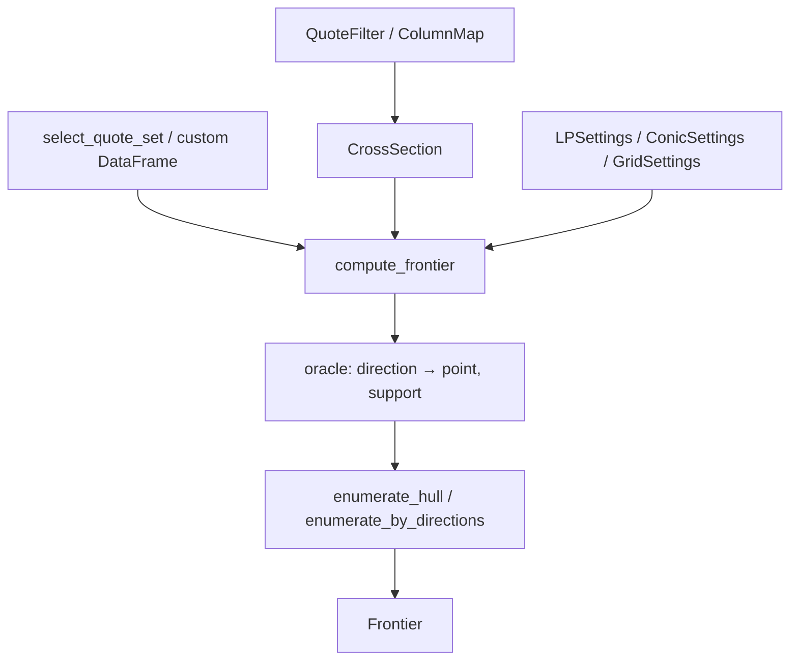

# Extension points

Change behaviour through the existing hooks. Do not duplicate quote rules in
`cli.py` or `plotting.py`. γ is only `{0,1,2}`; a new kernel must update the
façade, the model, the tests, and the CLI `choices` together.

## Hook map



| What to change | Touch first | Must stay in sync |
|---|---|---|
| Column names / dates / C-P | `data/schema.py`, `parse.py` | `tests/test_parse.py`, `test_schema.py` |
| Row filters | `QuoteFilter` | `tests/test_cross_section.py`, `asdict` on `Dataset.spec` |
| Quote sets / nested layers | `data/quote_sets.py` | `_NESTED_NAMES`, `config.COLORS/LABELS/SET_ORDER`, `plotting.SHORT_LABELS`, CLI `--sets` |
| LP tolerances / hull budget | `LPSettings` | `tests/test_lp.py`, `test_hull.py` |
| Cone solver ladder | `ConicSettings` | `tests/test_gamma1.py`, `test_gamma2.py` |
| Grid density | `GridSettings` | `tests/test_grid_enumeration.py` |
| New γ | see below | `compute_frontier`, `_physical_model`, CLI, `__init__`, synthetic truth |
| New reconstruction | implement the oracle protocol | `method` branch and `ValueError` list in `compute_frontier` |
| Parallel-readable sources | `Dataset.spec` / `from_spec` | `tests/test_series.py` pickle |

Root `__init__.py` does not export `Gamma1Model`, `select_quote_set`, or
`build_problem`. Extension code should import the submodules directly.

## Filters and schema

`QuoteFilter` is a frozen dataclass. New rules:

1. Add a row-level rule to `ROW_RULES` and count it in order in `apply_rows`.
2. After normalisation, add `NORMALIZED_RULES` and `apply_normalized`.
3. The union of `filter_report` is built in
   `build_cross_section._merge_reports`; `kept` must be the count **after
   normalised filtering**.
4. `Dataset.spec()` uses `asdict(QuoteFilter)`. New fields need defaults, or
   old specs cannot `from_spec`.

`ColumnMap`: long aliases go in `ALIASES`; short aliases are fallback only.
One raw column cannot map to two canonical fields.
`ColumnMap.optionmetrics()` is a fixed-name map and does not follow `detect`.

Do not change `norm_l`/`norm_u` inside a solver. The formulae belong only to
`_normalize`.

## Quote sets

`select_quote_set(quotes, K, name, design)` is the only named entry.
`design` is only `"riskneutral"` | `"physical"`.

To add a named set:

1. Write a selector that returns a DataFrame already `_finish`’d (stable sort
   by `strike, cp_flag, quote_id`).
2. Place it on one or both sides of `_NESTED_NAMES`; if it should be
   CLI-optional but not nested, add it to `_available_names` (currently only
   `full_panel` is extra).
3. Add one entry each to `config.SET_ORDER`, `COLORS`, `LABELS`, and
   `plotting.SHORT_LABELS`, or legends will cycle the palette and annotations
   will use the raw name.
4. Update the inclusion relations in `tests/test_quote_sets.py`.

**Do not** assume γ=0 can select `full_otm`. Default `design="riskneutral"`
names are `put_pair, local_eight, put_wing, full_panel`. To run all OTM on
the risk-neutral program, pass `design="physical"` or a custom table.

When `quote_set` is a `DataFrame`: `compute_frontier` does not call
`select_quote_set`; the name is fixed `"custom"`. The table must already be
CrossSection schema (at least `x, norm_l, norm_u`; γ=0 also needs
`strike, quote_id, cp_flag, bid, ask`).

`nested_frontiers(sets=...)` overrides the default layer names. Order is the
order used for half-plane accumulation and the shared relaxed budget; the
largest layer decides `full_strike_count`.

## Settings objects

Three frozen dataclasses, all pickleable, all passable whole to
`compute_frontier` / `frontier_series(..., lp_settings=...)`.

| Class | Common knobs | Side effects |
|---|---|---|
| `LPSettings` | `max_support_calls=500`; relaxed switches to `anytime_max_support_calls=160` and the area predicate | predicate relative tolerance `0.002`, absolute `1e-12` |
| `LPSettings` | `edge_tolerance=1e-8`, `point_tolerance=1e-9` | hull stop and unique-ing |
| `LPSettings` | `degenerate_tolerance=1e-10` | skip 2-D reconstruction if the marginal box is too narrow |
| `LPSettings` | `interior_cutoff=1e-8` | γ=0 Slater test |
| `ConicSettings` | `solver="CLARABEL"`, `fallbacks=("ECOS", "SCS")`, `violation_tolerance=1e-6` | rescue ladder and `ok` |
| `GridSettings` | `levels=(32,64,128)`, `max_normalized_gap=0.01` | only when `method="grid"` |

`support_cap` is not a Settings field; it is a `compute_frontier` argument.
`"auto"` / `None` / finite float: see `_resolve_support_cap`.

## Oracle protocol

Shared by `geometry/hull.py` and `geometry/grid.py`:

```text
oracle(unit_direction: (2,)) -> (unit_point: (2,), unit_support: float)
```

The caller owns the unit box. Façade adapters:

- `_SupportOracle`: `support(..., lexicographic=True)`, support value
  `upper_value` (dual upper bound, not `value`)
- `_PhysicalOracle`: `model.support`, support value `value`

A new reconstruction should depend only on this signature. Do not read quotes
or γ from the oracle. Failure should raise `SolverFailure`, not return a NaN
point.

`enumerate_hull` starts from 8 uniform directions, then adds points along
current-edge outer normals. `enumerate_by_directions` densifies the circle
by `levels`. Both outer-approximate on the unit square.

## New γ

`compute_frontier` entry:

```text
if gamma not in {0, 1, 2}:
    raise ValueError(...)
```

To add an integer kernel such as γ=3 (if it remains SOCP / a representable
cone):

1. New module, interface aligned with `Gamma2Model`: `support`,
   `feasibility`, `bounds("prob"|"loss")`, `depth_bounds`,
   `interior_margin`. `bounds("loss")` scales the objective internally and
   divides back (source coefficient 100).
2. Branch `_PHYSICAL_GAMMAS` and `_physical_model`.
3. `_resolve_support_cap`: whether the default remains `5.0`.
4. `_nested_names`, default `quote_set`/`design`/`method`.
5. CLI `--gamma` `choices`.
6. `true_targets` in `tests/synthetic.py` and closed-form scenes in the
   style of `tests/test_gamma*.py`.
7. Plot axes: `plotting._axis_labels` writes dedicated TeX only for 0 / 1 /
   2; other γ use generic English names.

Non-integer kernels have no ready `cones.py` primitive. Do not attach the
γ=0 slack budget to a physical model: the physical branch has no
hard/relaxed.

γ=1 and γ=2 are **not** the same cone with a changed exponent. γ=1 is linear
in the unscaled measure ($M_1=1$) and still needs a second normalisation for
depth; γ=2 uses Charnes–Cooper ($t=1/M_2$) and order-3 cell moments.
Copying `gamma2.py` and changing the number yields the wrong program.

## Data sources and parallelism

`Dataset.spec()` serialises **file-path** sources only. An in-memory
`DataFrame` option source raises `ValueError`. For a new source class to
enter `workers>1`:

- implement JSON-able constructor arguments
- round-trip `Dataset.spec` / `from_spec`
- keep the worker function at **module top-level**
  (`crashfrontier.series._series_worker`)

`QuoteFilter`, `ColumnMap`, paths, and the resolved `strike_scale` are
already in the spec. Open file handles, lambdas, and cvxpy `Problem` objects
must not go in `frontier_kwargs`.

## CLI

`cli.py` `_compute_options` maps argparse onto `compute_frontier` keywords.
New flags:

- add to `_add_frontier_options` or `_add_selection_options`
- map in `_compute_options`
- lock exit codes and the `--quote-set` / `--nested` exclusion in
  `tests/test_cli.py`

`--support-cap none|null|unbounded` parses to `None`
(`_parse_support_cap`). Do not pass the string `"none"` to the model.

`--resume` is a series CSV; `--cache` is a date-index directory. Do not reuse
the same path.

## Tests and synthetic truth

New quote rules: `synthetic_quotes` + `true_targets`; do not commit `DATA/`
fixtures. Shrink `GridSettings` for physical unit tests. Parallel tests
assert the worker `__module__ == "crashfrontier.series"`.

`Frontier.summary()` key order is `_SUMMARY_KEYS`. If export or series rows
build a dict by hand, include every key, or
`test_summary_keys_to_dict_and_contains` and `export.frontier_frames` will
misalign.

## Extensions not to make

- Import `physical/` from `riskneutral/`, or the reverse.
- Let `data/` depend on a solver.
- Merge AM/PM rows into one `CrossSection`.
- Fill `Frontier.area` with shoelace instead of `transformed_area`.
- Replace the γ>0 SOCP depth calculation with inner-vertex $L/p$; the inner
  range is only a numerical enclosure cross-check.
- Assume the series cache is bucketed by parameters.
- Write unverified defaults into package docs (check `config.py` and this
  guide).
