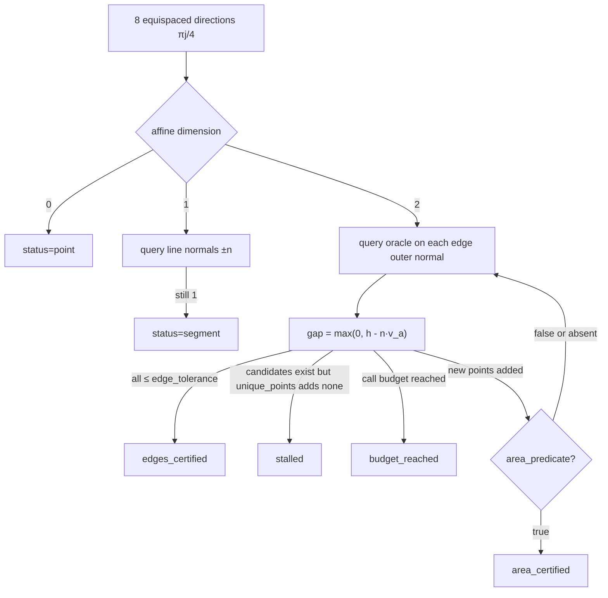

# Geometry: inner convex hull, outer half-planes, and adaptive reconstruction

Modules: `geometry/polygon.py`, `normalize.py`, `hull.py`, `grid.py`. Callers:
`_SupportOracle` / `_PhysicalOracle` in `frontier.py`.

## Coordinates

The solver evaluates the support function in **raw coordinates** $(p,L)$ or
$(q,\ell)$. Reconstruction runs in the **unit box**, so the two coordinates do
not differ by several orders of magnitude.

`BoxNormalizer(origin, scale)`:

$$
u=\frac{x-\mathrm{origin}}{\mathrm{scale}},\qquad
x=\mathrm{origin}+\mathrm{scale}\odot u
$$

Directions pull back as $a=u\oslash\mathrm{scale}$. Support values

$$
\bar h(u)=h_{\mathrm{raw}}(a)-a\cdot\mathrm{origin}
$$

`raw_halfplane` is the inverse map. Defaults: `origin=lo`, `scale=hi-lo`. If
either component is $\le\texttt{degenerate\_tolerance}$ ($10^{-10}$), the
degenerate path is used and two-dimensional reconstruction is skipped. Nested
γ>0 runs commonly reuse the `put_pair` box (`nested_frontiers`).

`test_box_normalizer_roundtrip_direction_and_halfplane` checks the round trip.

## Polygon primitives

| Function | Behaviour |
|---|---|
| `polygon_area` | shoelace; <3 points → 0 |
| `convex_hull` | `scipy.spatial.ConvexHull`, counterclockwise; degenerate or QhullError → unique input points |
| `clip_polygon` | Sutherland–Hodgman, keep $n\cdot x\le\mathrm{upper}+\mathrm{tol}$ |
| `halfplane_intersection` | see below |
| `point_in_convex_polygon` | special-case 1 point / segment, otherwise hull inequalities |
| `unique_points` | first-seen order; drop later points at distance ≤ tol |
| `affine_dimension` | $\mathrm{rank}(X-X_0)$, 0/1/2 |
| `segment_endpoints` | pair of maximal Euclidean distance |

`halfplane_intersection(normals, offsets, interior_points)`:

1. Unitise normals.
2. Push inward from the mean of `interior_points` (or the origin) along the
   most violated normal, at most 1000 steps.
3. If the largest angular gap among normals is $\ge\pi-\mathrm{tol}$, the
   intersection is unbounded and a `ValueError` is raised.
4. Initialise a square centred at that point with radius
   $\max(\mathrm{tol},\mathrm{slack}_{\max}/\cos(\mathrm{gap}/2))\cdot(1+100\,\mathrm{tol})$
   and clip by each half-plane. Empty set → `ValueError`.

`test_halfplane_intersection_unbounded_raises` covers the unbounded case.
`nested_frontiers` falls back to successive `clip_polygon` on the current
`outer` if the intersection fails, and restores the original `outer` if a clip
empties the polygon.

## Oracle contract

```text
oracle(unit_direction) -> (unit_point, unit_support)
```

`unit_direction` is a direction in the unit box (outer normals for hull,
equispaced unit vectors for grid). The returned point lies in the unit box;
`unit_support` is a **conservative upper bound** in that direction.

γ=0: `_SupportOracle` uses `SupportResult.upper_value` (includes the duality
gap).
γ>0: `_PhysicalOracle` uses `ConicPoint.value` (no gap correction on the
SOCP).

Every failure is `SolverFailure`, carrying the raw-coordinate direction.

Both reconstructions enlarge only: the clipping offset is
$\max(\bar h, \max_i n\cdot v_i)$, which keeps inner ⊂ outer.

## Adaptive hull `enumerate_hull`

Default at γ=0. `HullResult.status`: `point` | `segment` | `edges_certified` |
`area_certified` | `stalled` | `budget_reached`.



Outer polygon: start from the unit square $[0,1]^2$, clip by every `(n,h)`,
then take the convex hull with the inner vertices (`_outer_from_supports`).
The unit-box hypothesis is that the marginal box has already placed the set
near $[0,1]^2$; a true set that leaves the box is first truncated by the
square, then the “enlarge” step lifts the bound using inner vertices.

`area_predicate` is supplied only for γ=0 relaxed, via `_area_predicate`
(shoelace area difference). Hard mode and physical hull **do not** stop early
on area. `max_gap` may be NaN if area certification fires on the first round.

Tests: known triangle → 3 vertices, `edges_certified`, `max_gap≤10^{-8}`;
point/segment degeneracy; certificate half-planes contain inner; budget and
stalled.

## Direction grid `enumerate_by_directions`

Default at γ>0. `GridResult.status`: `converged` | `max_level`.

For `levels=(32,64,128)`, directions $\theta_i=2\pi i/L$ at each level.
Already-computed directions are reused by a 10-decimal key
(`test_direction_reuse_on_doubling_levels`).

$$
\mathrm{inner}=\mathrm{conv}\{x(u_i)\},\qquad
\mathrm{outer}=\bigcap_i\{x:u_i\cdot x\le \max(\bar h(u_i),\max_j u_i\cdot x_j)\}
$$

`max_gap`: $\max(h_{\mathrm{outer}}-h_{\mathrm{inner}},0)$ on $4L$ equispaced
check directions (`_GAP_CHECK_MULTIPLIER=4`). If `max_gap≤0.01` (unit box)
then `converged`; otherwise double the level, and emit `max_level` when the
schedule is exhausted.

`test_max_gap_is_nonincreasing_across_levels`. Physical-frontier tests use a
reduced grid `(16,)` / `(12,)` and `max_normalized_gap=0.08` for speed.

`GridResult.supports` columns: `direction_1, direction_2, point_1, point_2,
support` (unit box). `frontier._grid_halfplanes_to_raw` maps each row back to
a raw-coordinate half-plane.

## Degenerate path

If either marginal width is $\le 10^{-10}$: query support once on each of
$\pm e_1,\pm e_2$ (γ=0 with lexicographic order). After unique-ing, read the
affine dimension. 0 → a point; 1 or a misclassified 2 → segment endpoints.
`inner=outer`, area 0, `method="degenerate"`, `support_calls=4`.
`test_degenerate_box_uses_axis_supports`.

## Half-plane storage

`Frontier.halfplanes` has shape `(n,3)` in raw coordinates:

$$
a_{\mathrm{prob}}\,p+a_{\mathrm{loss}}\,L\le h
$$

`halfplane_table()` columns: `a_prob, a_loss, h`. Hull stores every
certificate; grid stores every direction at the accepted level; the degenerate
path stores the four axes.

After reconstruction, `inner` and `outer` pass through
`_clip_to_target_wedge`. Therefore **`halfplanes` and the final polygons need
not be equivalent constraint-wise**: the half-planes record the support
function; the wedge clip is post-processing. `contains` uses the clipped
polygon, not the half-plane table.

When nested accumulation is on, both polygons are re-intersected and
`halfplanes` is replaced by all planes accumulated through that layer.
`area`, `area_outer`, and `area_ratio` are then recomputed.

## `Frontier.contains`

```text
inside   : point in inner (boundary included)
outside  : point strictly outside outer
boundary : the rest (including the outer boundary and the shell between inner and outer)
```

`scenario_check` re-solves the program on `boundary`, because a point in the
shell may still be feasible or already infeasible.

## Relation to area

`polygon_area` is the hull anytime predicate (unit-box shoelace).
`Frontier.area` / `area_outer` are the **$p_0$-clipped transformed area**; see
the next page. Do not compare the two areas.
