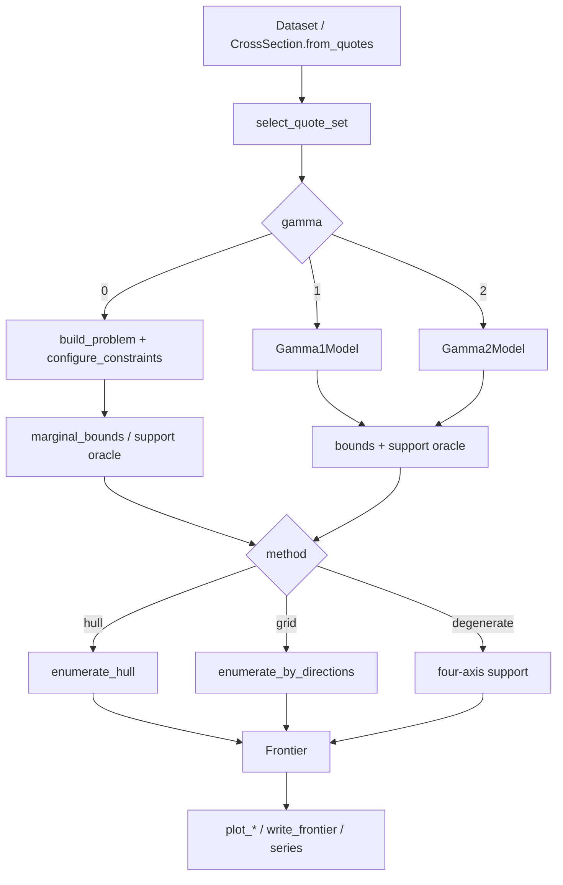

# Developer guide

This guide is for people who change the code, attach data sources, or check
numerical behaviour. It tracks the current package sources and `tests/`.

Package version: `crashfrontier.__version__ == "0.1.0"`. Public entry points
live in `crashfrontier/__init__.py`.

## How to read it

| Task | Start here |
|---|---|
| Who calls whom | [architecture.md](architecture.md) |
| Quote I/O or cross-section construction | [data-pipeline.md](data-pipeline.md) |
| γ=0 LP / dual certificates | [risk-neutral.md](risk-neutral.md) |
| γ=1/2 SOCP | [physical.md](physical.md) |
| Convex hull / grid reconstruction | [geometry.md](geometry.md) |
| Depth plot vs summary depth vs certified endpoints | [depth-transform.md](depth-transform.md) |
| Figures or CSV/JSON | [plotting-export.md](plotting-export.md) |
| Tenor / time-series parallelism | [series-parallel.md](series-parallel.md) |
| Tests or tolerances | [testing-numerics.md](testing-numerics.md) |
| New quote sets, γ, or reconstruction methods | [extending.md](extending.md) |

User-facing walkthroughs are [Getting started](../getting-started/install.md)
and [Examples](../examples/index.md). Signatures are in the
[Python API](../reference/api.md). This guide documents the internals behind
those pages rather than repeating their recipes.

## What the package does

`crashfrontier` computes the joint identified set of a **single cross-section**
(and the same computation repeated over tenors, thresholds, and dates):

- Input: OptionMetrics-style bid–ask quotes → `CrossSection`
- Output: `Frontier` (inner polygon, outer polygon, half-planes, marginals,
  depth, diagnostics) plus figures and tables

`gamma` switches the measure, not the colour scheme:

| `gamma` | Measure | Program | Default quote set | Default `support_cap` | Default reconstruction |
|---|---|---|---|---|---|
| `0` | risk-neutral $\mathbb Q$ | HiGHS LP | `put_wing` | unbounded | `hull` |
| `1` | power kernel $X^1/M_1$ | cvxpy SOCP | `full_otm` | `5.0` | `grid` |
| `2` | power kernel $X^2/M_2$ | cvxpy SOCP | `full_otm` | `5.0` | `grid` |

## Notation (and code column names)

Fix an observation date $t$ and expiry $T$. Forward $F$, discount
$D=\exp(-r\cdot\mathrm{days}/365)$ (`CrossSection.tau = days/365`; year length
is hard-coded 365). Normalised state $X=S_T/F$, normalised strike $x=\kappa/F$.
Each retained quote supplies an interval

$$
\underline c_i\le\mathbb E_{\mathbb Q}[(X-k_i)^+]\le\overline c_i
$$

Code columns: `norm_l`, `norm_u`. Puts enter the same call coordinates by
parity: `norm_l = bid/(DF)+1-x`. The model also requires
$\mathbb E_{\mathbb Q}[X]=1$. Default threshold $K=0.90$
(`DEFAULT_THRESHOLD`).

**γ=0** (risk-neutral):

$$
p_K=\mathbb Q(X\le K),\quad
L_K=\mathbb E_{\mathbb Q}[(K-X)^+],\quad
s_K=L_K/p_K\ (p_K>0)
$$

The joint set $\mathcal R_K$ is the closure of $(p_K,L_K)$ over
quote-compatible measures.

**γ>0** (physical):

$$
M_\gamma=\mathbb E_{\mathbb Q}[X^\gamma],\quad
A_r=\mathbb E_{\mathbb Q}[X^r 1\{X\le K\}]
$$

$$
q_{\gamma,K}=\frac{A_\gamma}{M_\gamma},\quad
\ell_{\gamma,K}=\frac{KA_\gamma-A_{\gamma+1}}{M_\gamma},\quad
s_{\gamma,K}=K-\frac{A_{\gamma+1}}{A_\gamma}=\frac{\ell}{q}
$$

Tables and `Frontier.summary()` use `prob` / `loss` / `depth` for both
coordinate systems. Plot axes change symbols with γ; see
[plotting-export.md](plotting-export.md).

## Main call chain

The façade is `compute_frontier` in `crashfrontier/frontier.py`. Nested sets,
scenarios, portfolio bounds, and binding quotes live in the same file.

## Defaults to keep in mind

These come from `crashfrontier/config.py` and the actual branches in
`compute_frontier`:

- $K=0.90$, $p_0=10^{-4}$, log-moneyness window `(-0.35, 0.05)`
- `QuoteFilter.min_volume=1.0`, calendar days `[7, 120]`
- `support_cap="auto"`: γ>0 → `5.0`; γ=0 → `None`
- `method="auto"`: γ=0 → `hull`; γ>0 → `grid`
- `quote_set=None`: γ=0 → `put_wing` + `design="riskneutral"`; γ>0 → `full_otm` + `design="physical"`
- Default `nested_frontiers` collections: three layers at γ=0; four layers at
  γ>0 (including `full_otm`)
- γ>0 `full_otm` + $B=5$ can be infeasible. The error suggests trying
  `put_wing` or `support_cap=None`
  (`tests/test_frontier.py` covers this with conflicting OTM calls)

## Papers

`crashfrontier` implements the methods developed in two papers by Jirong
Zhuang; citations and BibTeX entries are on
[Papers](../reference/papers.md).
