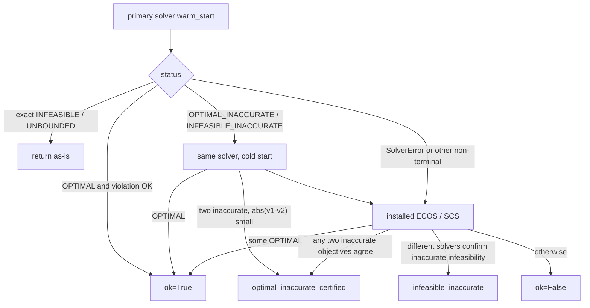

# γ=1/2: moments, SOCP, support_cap, and solver status

Modules: `physical/cones.py`, `solve.py`, `gamma2.py`, `gamma1.py`. Façade:
`frontier._compute_physical`, `_physical_model`.

The default physical specification is $\gamma=2$, $K=0.90$, $B=5$; $\gamma=1$
is exposed through the same interface. There is **no** hard/relaxed
slack fallback: infeasibility is `InfeasibleCrossSectionError`.

## Pricing kernel and targets

$$
\frac{\mathrm d\mathbb P_\gamma}{\mathrm d\mathbb Q}=\frac{X^\gamma}{M_\gamma},\qquad
M_\gamma=\mathbb E_{\mathbb Q}[X^\gamma]
$$

$$
q=\frac{A_\gamma}{M_\gamma},\qquad
\ell=\frac{KA_\gamma-A_{\gamma+1}}{M_\gamma},\qquad
s=K-\frac{A_{\gamma+1}}{A_\gamma}
$$

The atom $a_K=\mathbb Q\{K\}$ adds $K^\gamma a_K/M_\gamma$ to $q$ and 0 to
$\ell$ (`test_threshold_atom_enters_probability_and_cancels_from_loss`).

Both models constrain the target to the wedge

$$
0\le q\le 1,\qquad 0\le \ell\le Kq
$$

These bounds are enforced as explicit box constraints in the source.

## Shared construction rules

`Gamma1Model` / `Gamma2Model` `__init__`:

1. $K\in(0,1)$, otherwise `ValueError`.
2. Drop non-finite rows, $x<0$, or `norm_l>norm_u`; fewer than 2 distinct $x$
   → `ValueError`.
3. A finite `support_cap` must be $> \max(1,K)$. If
   $x\ge B-5\cdot10^{-12}$ and `norm_l>10^{-10}` →
   `ValueError("positive call bid is incompatible with support cap")`;
   otherwise those rows are dropped. After the drop, fewer than two strikes
   raises again.
4. Boundaries
   $b=\mathrm{unique}(\mathrm{round}(\{0\}\cup\{x_i\}\cup\{K\}\cup\{B\},12))$.
   With $B$, `n_cells=len(b)-1` (last right endpoint is $B$); without $B$,
   `n_cells=len(b)` (last cell $[b_J,\infty)$, `_right_endpoint` is `None`).
5. `threshold_cell`: the unique index in `cell_starts` equal to $K`.

Pinned example: $x\in\{0.8,1.0\}$, $K=0.9$, $B=5$ →

```text
boundaries = [0, 0.8, 0.9, 1.0, 5]
n_cells = 4
cell_starts = [0, 0.8, 0.9, 1.0]
threshold_cell = 2
```

Without $B$: `boundaries=[0,0.8,0.9,1.0]`, `n_cells` still 4, last right
endpoint `None`.

## Moment cones (`cones.py`)

`psd2(u,v,w)` means $\begin{pmatrix}u&v\\v&w\end{pmatrix}\succeq 0$:

$$
u\ge 0,\ w\ge 0,\ \|(2v,\ u-w)\|_2 \le u+w
$$

`moment_cone_order3` on $[a,b]$: one `psd2` after a left shift and one after
a right shift. Unbounded $[a,\infty)$: `psd2(y0,y1,y2)` plus the order-3 left
shift.
`moment_cone_order2`: `psd2(y0,y1,y2)` and $y_1\ge a y_0$; if bounded, also
$y_1\le b y_0$ and $y_2\le(a+b)y_1-ab y_0$.

`test_psd2_*` and `test_moment_cone_order*` accept Dirac masses and
indefinite matrices.

## γ=2: Charnes–Cooper

Variables: `y` of shape `(4, n_cells)` (cell moments of order 0–3), `t≥0`
(i.e. $\rho=1/M_2$), `atom≥0`.

Structure:

$$
\sum_j y_{0j}=t,\quad
\sum_j y_{1j}=t,\quad
\sum_j y_{2j}=1
$$

- $j<\tau$: order-3 moment cone, right endpoint $b_{j+1}$
- $j\ge\tau$: order-2 moment cone on $(y_{0j},y_{1j},y_{2j})$; at $j=\tau$
  first subtract the atom $(a, aK, aK^2)$; force $y_{3j}=0$
- Last-cell right endpoint: $B$ if present, else `None`

Quotes:

$$
\underline c_i\, t \le \sum_{b_j\ge k_i}(y_{1j}-k_i y_{0j}) \le \overline c_i\, t
$$

Targets (after scaling):

$$
q=\sum_{j<\tau} y_{2j}+K^2 a,\qquad
\ell=K\sum_{j<\tau} y_{2j}-\sum_{j<\tau} y_{3j}
$$

`direction` is `cp.Parameter(2)`. `support` first divides the direction by
$\max(\|u\|_\infty,1)$, maximises $u\cdot(q,\ell)$, and multiplies `value`
by the scale on return. `feasibility` is $u=(0,0)$.

If `direction·point` differs from the solver objective by more than
`objective_tolerance·(1+|v|)`, the point is a failure.

## γ=1

Variables: `z` (mass), `m` (first moment), `v` (second moment on
below-threshold cells only, length $\tau$), `atom`.

Linear structure: $\sum z=1$, $\sum m=1$; $m_j\ge b_j z_j$, and
$m_j\le b_{j+1}z_j$ when a right endpoint exists. Atom: $a\le z_\tau$; with a
right endpoint, $m_\tau\le b_{\tau+1}z_\tau-(b_{\tau+1}-K)a$.

Below-threshold SOC: $v_j z_j\ge m_j^2$, written
`SOC(z_j+v_j, [2m_j, z_j-v_j])`, plus
$v_j\le(b_j+b_{j+1})m_j-b_j b_{j+1}z_j`.
`test_below_threshold_cells_use_second_moment_soc` asserts that the SOC count
equals `threshold_cell`.

Quotes are **not** multiplied by a scale factor ($M_1=1$ is pinned by the
forward):

$$
\underline c_i\le \sum_{b_j\ge k_i}(m_j-k_i z_j)\le\overline c_i
$$

Targets:

$$
q=\sum_{j<\tau}m_j+K a,\qquad
\ell=K\sum_{j<\tau}m_j-\sum_{j<\tau}v_j
$$

## Marginal bounds and depth certification

`bounds("prob"|"loss")`: `hi=support(+e).value`,
`lo=-support(-e).value`. Both coordinates use unit directions. Checks:
`lo≥-1e-6`, `hi≤` logical upper bound $+1e-6$ (prob upper 1, loss upper
$K$), `lo≤hi+1e-8`; then clip to $[0,$ logical upper $]$. Failure returns
`(nan, nan, inf)`.

`depth_bounds` is a **second normalisation**, not $L/q$ on joint-set
vertices:

- Inspect `prob_hi`. If `< minimum_prob_upper` (default $10^{-4}$) →
  `(nan, nan, violation, False)`: crash mass is negligible and depth is
  undefined.
- γ=2: new variables $h$ (4 × cells), $\lambda=1/A_2$, atom;
  $\sum h_0=\sum h_1=\lambda$, the same moment cones and quotes (times
  $\lambda$), constraint $\sum_{j<\tau}h_{2j}+K^2 a=1$, objective
  $\mathrm{depth}=K\sum h_2-\sum h_3\in[0,K]$.
- γ=1: $\lambda=1/A_1$, $\sum z=\sum m=\lambda$, quotes times $\lambda$,
  $\sum_{j<\tau}m_j+K a=1$.

If direct `Minimize`/`Maximize` fails, `_bisect_depth` uses at most 40
feasibility steps on $[0,K]$ and stops once the bracket is within $10^{-6}$.
Only certified attained or rejected cuts move the bracket. Solver errors and
uncertified inaccurate statuses stop the search and return the conservative
outer side of the current bracket (`depth_bracket_bound`), never the last
attained interior cut. If no interior cut is certified, the base program
first certifies that the uncut system is feasible.

The direct depth objective is scaled by 100 before it reaches the solver and
then converted back to depth units. `diagnostics["solver_depth_lo/hi"]` retain
that SOCP pair; $L/p$ on the reconstructed polygon is stored as
`diagnostics["inner_depth_lo/hi"]`. Numerically unresolved inner points below
`diagnostics["inner_depth_probability_floor"]` are excluded from this ratio
check. If the resolved inner range extends outside the solver range by at
most `5e-3`, `Frontier.depth_lo/hi` conservatively expand to enclose it, and
`diagnostics["depth_reconciled"]` records whether widening occurred. A larger
outward extension sets the public depth endpoints to NaN and
`diagnostics["depth_enclosure_ok"]` to `False`; it does not discard the joint
frontier.

## Identification content of support_cap

Without an upper bound, an arbitrarily small mass at infinity can
inflate $M_2$, so

$$
\inf q_{2,K}=\inf \ell_{2,K}=0
$$

`test_unbounded_cap_sends_prob_lo_to_zero` (γ=2, synthetic,
`support_cap=None`) requires `prob_lo<10^{-3}`. The γ=1 counterpart **only
asserts feasibility and an open last cell**, not `prob_lo→0`: the denominator
$M_1=1$ is pinned, so the γ≤1 collapse follows a different construction.

`Gamma2Model.m2_bounds()` reports this same homogeneous closure explicitly:
if the minimizing normalization $t=1/M_2$ is numerically indistinguishable
from zero under unbounded support, the upper endpoint is `inf`, not a huge
finite pseudo-moment.

A finite $B$ tightens the right tail. `test_support_cap_tightens_prob_interval`
(γ=1) requires the finite-cap interval to lie inside the unbounded interval
(tolerance $2\cdot10^{-6}$).

`compute_frontier(..., support_cap="auto")`: γ>0 → `5.0`. Explicit `None` or
CLI `--support-cap none` is unbounded. Do not treat dropping $B$ as a switch
that makes `full_otm` plottable.

Default quote set `full_otm` at $B=5$ can be physically inconsistent with OTM
calls, while `put_wing` on the same cross-section may still be feasible
(`test_physical_infeasible_full_otm_raises_with_metadata`). The error suggests
`put_wing` and `support_cap=None` as alternatives to try.

## Interior margin

γ=2: on the **full** structural constraints, change quotes to
$C_i\ge \underline c_i t+\mathrm{margin}$,
$C_i\le\overline c_i t-\mathrm{margin}$, and maximise `margin≥0`. Holds when
`margin>10^{-10}` and `violation≤10^{-6}`. Zero spread gives margin≈0,
`ok=False`.

γ=1: **linear** structure only (no SOC), same form as RN $\eta$:
$\eta\in[0,1/2]$, tightened by `width_i`. Zero width returns
`(False, 0, 0, "zero_width_quote")` without solving a cone. Therefore γ=1
`interior_ok` does not prove that the second-moment cones have nonempty
interior.

`interior_ok=False` only warns (`_PHYSICAL_INTERIOR_WARNING`) and does not
abort.

## Solver state machine

`solve_with_rescue` (`physical/solve.py`):



`ok` also requires a finite objective and
`violation ≤ violation_tolerance`. SOC residuals are
$\max(\|t\|_2-s,0)$ by hand, not cvxpy’s `violation()`.

Status strings (appear on `ConicPoint.status` /
`Frontier.diagnostics["statuses"]`):

| Status | Meaning |
|---|---|
| `optimal` | cvxpy `OPTIMAL` |
| `optimal_inaccurate` | single inaccurate solve that passed the violation test (intermediate only; rewritten if never certified) |
| `optimal_inaccurate_certified` | two inaccurate objectives within relative tolerance; keep the smaller violation; `solver` written as `A\|B` |
| `uncertified_optimal_inaccurate` | inaccurate results disagree |
| `solver_error` | `cp.error.SolverError` |
| `infeasible` / `unbounded` / … | exact terminal status |
| `infeasible_inaccurate` | accepted only after confirmation by a different solver |
| `uncertified_infeasible_inaccurate` | inaccurate infeasibility was not cross-confirmed |
| `bisect_failed` | depth bisection only |

The library filters cvxpy’s `"Solution may be inaccurate"` UserWarning on
import of `solve.py`. pytest is configured to filter the same warning.

CLARABEL options: `tol_gap_abs/rel`, `tol_feas`, `max_iter`. ECOS:
`abstol/reltol/feastol`, `max_iters`. SCS: **fixed** `eps=1e-6`,
`max_iters=20000`; does not read `ConicSettings.tolerance`.

`warm_start`: only when the previous direction and the current (already
unitised) direction `allclose`, and only on the **same** `support_problem`.
`feasibility` is `support((0,0))` and can therefore warm-start.
`interior_margin` / `depth` / `scenario` pass `warm_start=False`.

## Hook-up to Frontier

- `mode="socp"`, default `support_cap` 5.
- Default `method="grid"`. `summary()["solver_gap"]` = `max_violation`
  (largest finite violation among interior, feasibility, marginals, and
  support calls).
- `max_duality_gap` is NaN for physical.
- Inner and outer polygons are clipped to the target wedge. Nested runs
  accumulate half-planes on both polygons by default, replace the stored
  half-plane set, and share the `put_pair` unit box.
- `Gamma2Model.oracle` / `Gamma1Model.oracle` exist, but `compute_frontier`
  uses `_PhysicalOracle`; the logic is equivalent.

## Test anchors

Synthetic truth tolerances: targets $2\cdot10^{-6}$, depth $2\cdot10^{-5}$,
violation $10^{-6}$ (`tests/test_gamma1.py`, `test_gamma2.py`).
`support` points satisfy $u\cdot x\approx\mathrm{value}$ ($10^{-7}$).
γ=1 `value` is homogeneous when the direction is scaled by 250
(`test_support_scales_large_directions`).
