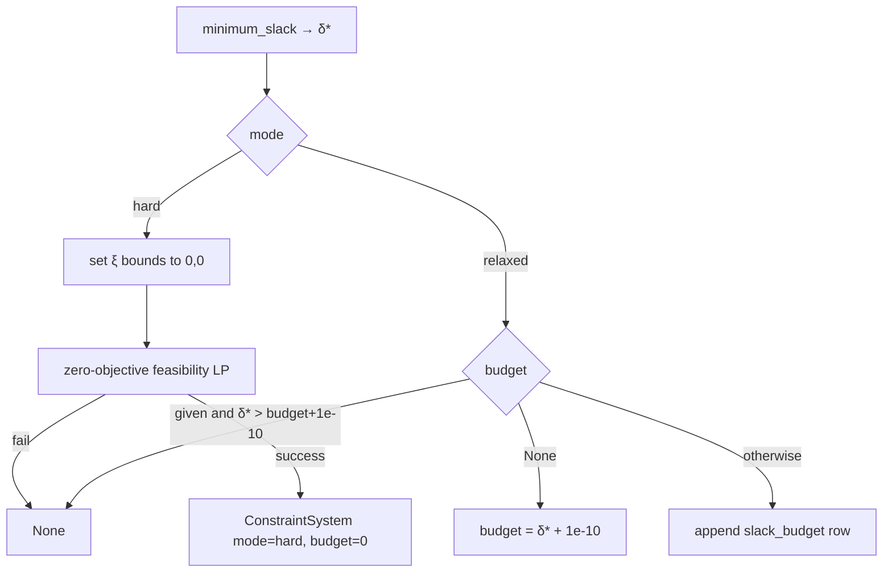

# γ=0: hard / relaxed LP and dual certificates

Modules: `crashfrontier/riskneutral/lp.py`, `certificates.py`. Façade:
`configure_constraints`, `binding_quotes`, `portfolio_bound`.

## Finite system

`build_problem(quotes, K, full_strike_count=None)`. Quotes must contain
`x, norm_l, norm_u, strike, quote_id, cp_flag, bid, ask`. Rows that are
non-finite or have `norm_l>norm_u` are dropped. Fewer than 2 distinct strikes
→ `ValueError`.

Boundaries

$$
b=\mathrm{unique}(\mathrm{round}(\{0\}\cup\{x_i\}\cup\{K\},12))
$$

Cell count `n_cells = len(b)`: bounded cells $[b_j,b_{j+1})$, last cell
$[b_J,\infty)$. $K$ must appear exactly once on $b$ (`atol=5e-12`),
`threshold_cell = j_K`.

Variables $y\ge 0$ (`bounds=(0,None)`), length $2(J+1)+2n+1$:

| Block | Index | Meaning |
|---|---|---|
| $z_0\ldots z_J$ | `0 : n_cells` | cell mass |
| $m_0\ldots m_J$ | `n_cells : 2 n_cells` | cell first moments |
| $\xi^-_i$ | `slack_lower` | bid slack |
| $\xi^+_i$ | `slack_upper` | ask slack |
| $a_K$ | `atom_index` | threshold atom |

Inequalities (`row_names` in this order):

1. Per cell: $b_j z_j - m_j \le 0$ (`cell_{j}_moment_lower`); for $j<J$ also
   $m_j - b_{j+1}z_j\le 0$. The last cell has no upper-bound row.
2. Quote $k_i$: call price
   $c_i=\sum_{b_j\ge k_i-10^{-11}}(m_j-k_i z_j)$.
   $c_i-\xi^+_i\le \overline c_i$ (`quote_{id}_ask`),
   $-c_i-\xi^-_i\le -\underline c_i$ (`quote_{id}_bid`).
3. Atom: $a_K-z_{j_K}\le 0$ (`threshold_atom_mass`); if $j_K<J$:
   $m_{j_K}-b_{j_K+1}z_{j_K}+(b_{j_K+1}-K)a_K\le 0$.

Equalities: $\sum z=1$, $\sum m=1$.

Objective vectors (projections, not a solver objective):

$$
p=\sum_{j<j_K}z_j+a_K,\qquad
L=K\sum_{j<j_K}z_j-\sum_{j<j_K}m_j
$$

That is `p_target[:j_K]=1`, `p_target[atom]=1`; `loss_target[:j_K]=K`,
`loss_target[m-block :j_K]=-1`. The atom coefficient on $L$ is 0: mass at $K$
raises $p$ and does not raise $L$.

Slack weights:

$$
w_i=\frac{1}{N_{\mathrm{full}}\cdot n(k_i)}
$$

$N_{\mathrm{full}}$ defaults to the number of distinct strikes in this set;
nested runs pass `full_strike_count` from the largest set. $n(k_i)$ is the
number of rows at that strike in this set. `slack_objective` equals $w_i$ on
$\xi^\pm$.

Layout is pinned by `test_variable_layout_row_names_and_slack_weights`.
Example: $x\in\{0.8,1.0\}$, $K=0.9$ → $b=(0,0.8,0.9,1.0)$, `n_cells=4`,
`threshold_cell=2`, last cell has only a lower bound.

## hard and relaxed

`configure_constraints(problem, settings, mode, budget=None)` first computes
`minimum_slack`: minimise $\sum w(\xi^-+\xi^+)$. A solver failure returns
`None`.

`mode="auto"` is implemented in the frontier façade, not inside
`configure_constraints`: try hard, then relaxed on `None`. On a successful
fallback, `logger.warning("quotes admit no arbitrage-free measure; using minimum slack budget δ*")`
and `Frontier.diagnostics["relaxed"]=True`.

A single self-contradictory row (`norm_l>norm_u`) is dropped in
`build_problem`, so hard may still be feasible
(`test_inverted_row_is_dropped_and_hard_stays_feasible`). **Cross-row**
disjoint intervals at the same strike make hard fail and give relaxed
$\delta^\star>0$ (`test_relaxed_recovers_cross_quote_inconsistency`).

`impose_support_cap(system, B)` appends

$$
m_J - B z_J \le 0
$$

with row name `support_cap`. γ=0 does not add it by default.

## Solver

`solve_lp`: `scipy.optimize.linprog(method="highs-ds")`, primal/dual
feasibility $10^{-10}$, `time_limit=5`. If `status==4` or the message contains
`"model_status is Unknown"`, switch to `highs-ipm`. If the fallback also
fails, return the first result.

## Support function

`support(system, settings, direction, lexicographic=True)` maximises
$u\cdot(p,L)$.

Implementation: $\mathrm{scale}=\max(\|u\|_\infty,1)$, minimise
$-\mathrm{target}$, where
$\mathrm{target}=(u_p p_{\mathrm{target}}+u_L L_{\mathrm{target}})/\mathrm{scale}$.

Validation `_valid_lp_solution`: `success`, finite,
$\|x\|_\infty\le 10^6$, equality/inequality residuals
$\le\max(5\cdot10^{-10},5\cdot\mathrm{primal\_tol})$, variables inside
bounds. Failure → `success=False`.

Raw-problem optimum `value = -fun * scale`.

### SciPy dual sign (required reading)

HiGHS `ineqlin.marginals` / `eqlin.marginals` are **derivatives of the
minimisation objective with respect to the RHS** $\partial\mathrm{fun}/\partial b$,
not textbook $\lambda\ge 0$. Inequality multipliers are typically ≤ 0.

Minimisation dual value:

$$
\mathrm{dual}_{\min}=b_{\mathrm{ub}}\cdot\lambda+b_{\mathrm{eq}}\cdot\nu
$$

Unscaled maximisation dual:

$$
\mathrm{dual}=-\mathrm{dual}_{\min}\cdot\mathrm{scale}
$$

`duality_gap=|\mathrm{dual}-\mathrm{value}|`,
`upper_value=\mathrm{value}+\mathrm{duality\_gap}`. Outer approximations and
marginal upper bounds use `upper_value`, so the outer envelope enlarges only.

Hand-check: `test_linprog_marginals_match_hand_example`. Formula check:
`test_support_dual_matches_scipy_marginal_formula`. Dot products use
`math.fsum`.

Lexicographic: append the equality
$(u_p p+u_L L)\cdot y=\mathrm{value}$, then maximise the rotated direction
$(-u_L,u_p)/\mathrm{scale}$ to push a face point to an endpoint. `point`
comes from the secondary solve (or the primary if that fails).
`face_shortfall=\max(0,\mathrm{value}-u\cdot\mathrm{point})$. Reconstruction
oracles use `lexicographic=True`; `binding_quotes` and `marginal_bounds` use
`False`.

Directions are homogeneous in $\mathrm{scale}$:
`test_support_value_scales_with_direction`.

## Marginals, portfolios, scenarios

`marginal_bounds`: $\pm e_1,\pm e_2$, `lexicographic=False`.

$$
h_i=\mathrm{upper\_value}(e_i),\quad
\ell_i=-\mathrm{upper\_value}(-e_i),\quad
\mathrm{lo}=\max(\ell,0),\ \mathrm{hi}=\max(h,\mathrm{lo})
$$

`portfolio_bounds(u_p,u_L)` returns $(-h(-u), h(u))$, where $h$ is
**`value`, not `upper_value`**. Numerically close to `Frontier.lo/hi` (which
use upper) but a different definition. `test_scenario_portfolio_and_binding`
aligns $u=(1,0)$ with `lo[0]`/`hi[0]` at `abs=5e-6`.

`scenario_feasible`: append $p_{\mathrm{target}}\cdot y=p$,
$L_{\mathrm{target}}\cdot y=L$, zero objective, `_valid_lp_solution` (default
tolerance $10^{-9}$).

## Interior condition $\eta^\star$

`certificates.interior_margin(problem, settings)` is defined only on a
**hard system with slacks fixed at 0**. Introduce $\eta\in[0,1/2]$, add
`width_i·η` to each quote’s ask/bid row, and maximise $\eta$.

$$
\underline c_i+\eta(\overline c_i-\underline c_i)
\le c_i
\le\overline c_i-\eta(\overline c_i-\underline c_i)
$$

`compute_frontier` `_interior_state`: relaxed → `interior_ok=False`,
`interior_margin=nan`. Hard also requires every `width_i>0` and
$\eta^\star>\texttt{interior\_cutoff}$ ($10^{-8}$). A zero-width quote clamps
$\eta^\star$ to 0 (the function forces 0 when `widths<=0`).

This is a diagnostic, not a feasibility switch: `interior_ok=False` still
computes the frontier.

## Dual certificates

`dual_certificate(system, result)` reads multipliers from the **primary**
`primary`. Negate the SciPy multipliers and multiply by `scale` to obtain
weights for the maximisation problem.

- Ask weight $=\lambda_{\mathrm{displayed}}$; bid weight
  $=-\lambda_{\mathrm{displayed}}$ (minus sign = sell at the bid). On a hard
  system this makes

  $$
  \mathrm{cash}+\mathrm{forward}+\sum \mathrm{weight}\cdot\mathrm{norm\_price}
  $$

  equal `support_value`
  (`test_dual_certificate_static_cost_matches_support_value`, tolerance
  $10^{-8}$).
- `cash = -scale·ν_0`, `forward = -scale·ν_1` (mass and first-moment
  equalities).
- Include rows with $|\lambda|>10^{-8}$ or inequality residual $<10^{-8}$.
- `structural`: cells, atom, `slack_budget`, `support_cap`.
- `threshold_atom`: primal variable $a_K$.
- `primal_dual_gap`: minimisation $|fun-(b\cdot\lambda+b_{\mathrm{eq}}\cdot\nu)|$.
- Stationarity: $c-A_{\mathrm{ub}}^\top\lambda-A_{\mathrm{eq}}^\top\nu-$ bound
  duals; complementarity: $\max|\lambda\odot\mathrm{residual}|$.

`DualCertificate.to_frame()` columns: `kind, label, weight`.
`binding_quotes` switches to relaxed when hard is infeasible;
`structural` then contains `slack_budget`, and a warning is logged.

The direction is recovered from stationarity by least squares
(`_direction_over_scale`) and multiplied by scale; it should match the
incoming direction numerically.

## Hook-up to Frontier

γ=0 reconstruction defaults to hull. Relaxed adds the area predicate

$$
\mathrm{area}(\mathrm{outer})-\mathrm{area}(\mathrm{inner})
\le 10^{-12}+0.002\cdot\mathrm{area}(\mathrm{outer})
$$

and `max_calls=anytime_max_support_calls` (160). Hard uses 500 calls and no
area early-stop.

`Frontier.mode` is `"hard"` or `"relaxed"`. `diagnostics`: `support_calls`,
`max_gap`, `max_duality_gap`, `budget`, `minimum_slack`, `statuses`,
`elapsed_seconds`, `relaxed`. `summary()["solver_gap"]` =
`max_duality_gap`.

`depth_lo`/`depth_hi` are the min/max of $L/p$ on **inner vertices** with
$p>0$. There is **no** second LP and **no** $p_0$ clip. This differs from
γ>0; see [depth-transform.md](depth-transform.md).

## Test anchors

`tests/test_lp.py`: five scenes × two thresholds; hard feasible,
$\delta^\star\approx 0$, truth inside the marginals ($2\cdot10^{-7}$),
`duality_gap<10^{-9}`, `upper_value=value+gap`.
`tests/test_certificates.py`: $\eta^\star>10^{-8}$ at `spread=1e-4`;
zero-width $\eta=0$; cost identity; relaxed contains `slack_budget`.
