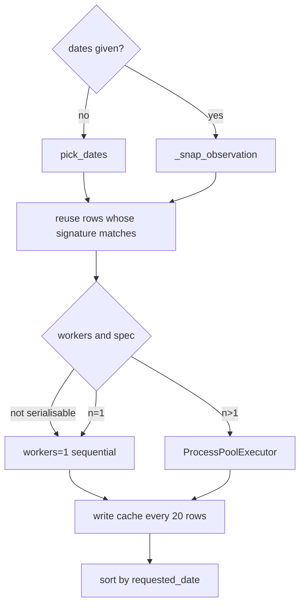

# Time series: parallelism, cache, and error isolation

Module: `crashfrontier/series.py`. CLI: `term`, `series`.

## Three entry points

| Function | Input | Success value | Failure |
|---|---|---|---|
| `term_structure(ds, date, tenors=…)` | several target days on one date | `(DataFrame, {tenor: Frontier})` | in-row `error`; dict omits that tenor |
| `threshold_profile(cs, thresholds=…)` | several $K$ on one cross-section | `(DataFrame, {K: Frontier})` | same |
| `frontier_series(ds, …)` | date list or a sample | DataFrame only (no Frontier dict) | in-row `error` or the whole table raises |

Summary columns = the fixed `Frontier.summary()` keys, plus:

- tenors: `target_days`, `error`
- thresholds: `error`
- series: `requested_date`, `error`

An empty-string `error` means success. Filter before plotting.

## Term structure

Default tenors `(7,14,30,60,90)`, `window_fraction=0.35`. For target $t$:

$$
\mathrm{window}=\bigl(\max(d_{\min},\mathrm{round}(t(1-f))),\ \min(d_{\max},\mathrm{round}(t(1+f)))\bigr)
$$

$d_{\min}/d_{\max}$ come from `Dataset._quote_filter`. Then
`cross_section(..., target_days=t, window=..., am_settlement=...)`.

**One expiry serves only one tenor**: `_drop_duplicate_expiries` keeps the
smaller `|days-tenor|` and writes `error="expiry already used"` on the rest.
On synthetic data `(7,8)` drops 8
(`test_term_structure_records_errors_and_duplicate_expiry`). The default five
tenors on the mini data usually succeed at 7/14/30 and fail at 60/90 for lack
of contracts in the window.

A single failure (expiry selection or solve) does not abort the loop.
Caught: `CrashFrontierError` and `ValueError`.

## Threshold profile

Calls `compute_frontier` for each $K$. No parallelism. Failures write
`error`.

## Date sampling `pick_dates`

| `freq` | Rule |
|---|---|
| `D` | every available date in the interval |
| `W` | one day per `W-SUN` week by `WEEKDAY_PRIORITY=(2,1,3,0,4)` (Wednesday first, then Tuesday, Thursday, Monday, Friday) |
| `M` | last available date of each month |
| `Q` | last available date of each quarter |

Any other `freq` → `ValueError`. `start`/`end` clip before sampling
(endpoints included).

## `frontier_series` flow

Per date: `cross_section(used, days=… or target_days=… + window)` →
`compute_frontier` → `summary()`.

Defaults: `target_days=30`, `window=(20,45)`, `freq="W"`, `snap="backward"`,
`on_error="skip"`, `workers=1`. If `days` is passed, `target_days`/`window`
are ignored.

### Alignment `snap`

When the requested date is not in `available_dates`:

- `"backward"` / `"forward"`: `Dataset.nearest_date`
- `None`: `NoSuchDateError`

`requested_date` remains the request; `date` is the actual observation.
`test_frontier_series_snap_and_on_error`: `2021-07-23` snaps backward to
`2021-07-22`.

### Error isolation

`on_error="skip"`: catch `_ITEM_ERRORS = (CrashFrontierError, ValueError)`,
write an `error` row. If a cross-section was already built, the row still
fills `date/expiry/forward/...`.
`on_error="raise"`: re-raise as-is.
`KeyboardInterrupt`, `MemoryError`, and anything else not on the list abort.

`term_structure` has **no** `on_error` switch; behaviour equals skip.

### Parallelism

`workers>1` calls `Dataset.spec()`. An in-memory source raises `ValueError` →
warning `in-memory ... using workers=1`
(`test_memory_source_falls_back_to_one_worker`).

Workers: `ProcessPoolExecutor(initializer=_init_series_worker,
initargs=(spec,))`. The task function `_series_worker` must be **module
top-level** so it can be pickled
(`test_worker_is_module_top_level_and_pickleable`). Each job carries a copy
of `frontier_kwargs`. `tqdm` wraps `as_completed`.

`LPSettings` / `ConicSettings` are frozen dataclasses and pickle. Do not put
open file handles or lambdas in kwargs.

The parent and the workers **do not share** already-loaded option frames;
each worker rebuilds a `Dataset` from the spec (each opens files/indexes).

Sequential and `workers=2` agree on a synthetic three-day summary (drop
`elapsed_seconds`, `atol=1e-9`).

### Cache

`cache_path` points at one CSV. A successful row is skipped only when a stable signature of the inputs that change the result matches, including `requested_date`, \(K\), `gamma`, quote set, support cap, and the cross-section selection. Rows with a non-empty `error` are recomputed. A cache that does not store the signature is recomputed. After every `SERIES_CACHE_FLUSH=20` new dates, write atomically (`.tmp` + `replace`). Write the full table again at the end.

Missing `requested_date` column or an empty file → treat as empty cache (no warning).
Unreadable CSV → warning, treat as empty cache.

CLI: `series --resume PATH.csv` is `cache_path`. Global `--cache DIR` is the
date-index directory. `test_series_resume_is_not_global_cache`.

Parallel flushes write “completed subset + old cache”, not global date order;
the return value is re-sorted by `requested` and rewritten.

## Error-row shape

`_error_row`: summary numeric columns NaN, dates `NaT`, `error` the
message. Keep `quote_set` and `n_strikes` when they are already known.
`_finalize_table` clears `"nan"` strings in `error` to empty. Resume
recomputes these rows.

## Plotting

`plot_term_structure` / `plot_threshold_profile` / `plot_time_series` all skip
rows with nonempty `error`. Time-series failures are not interpolated.
