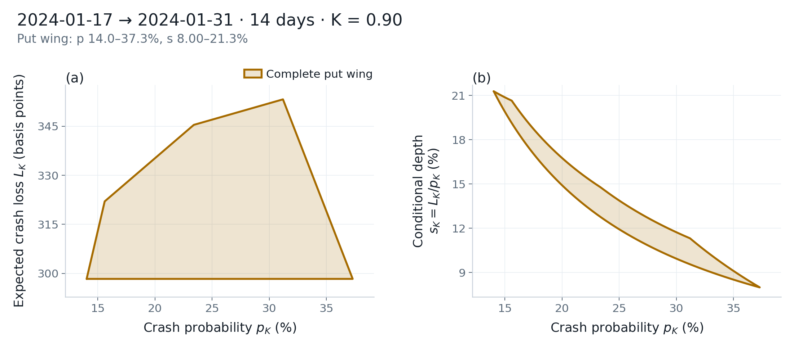
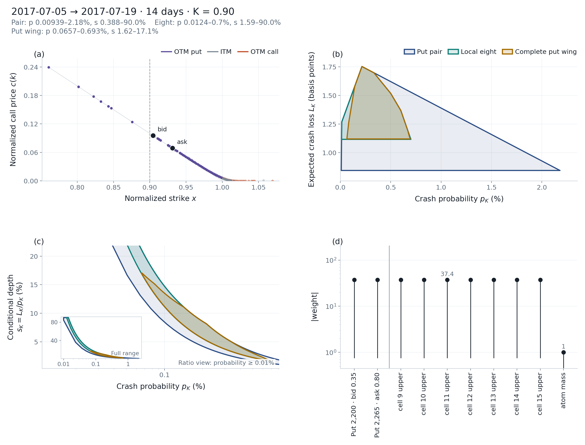
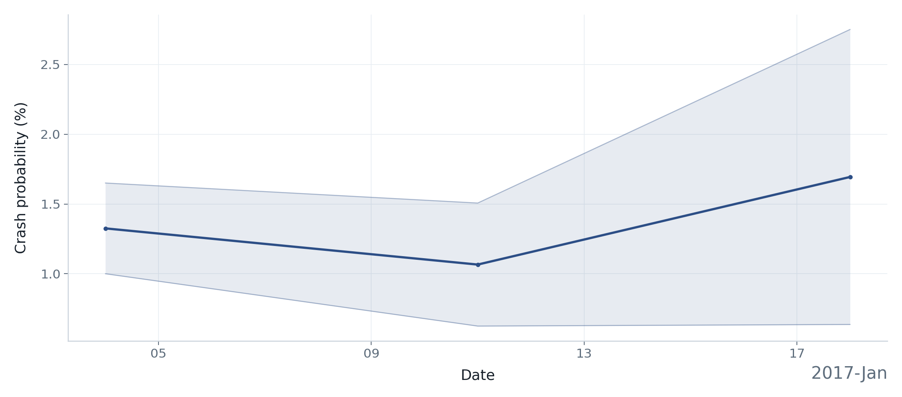
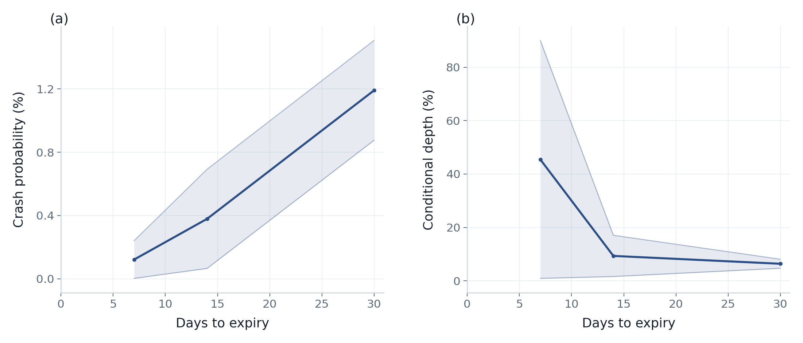
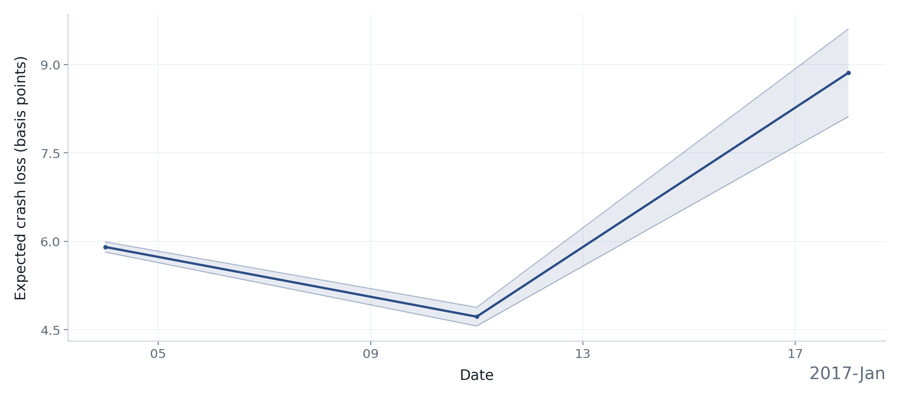
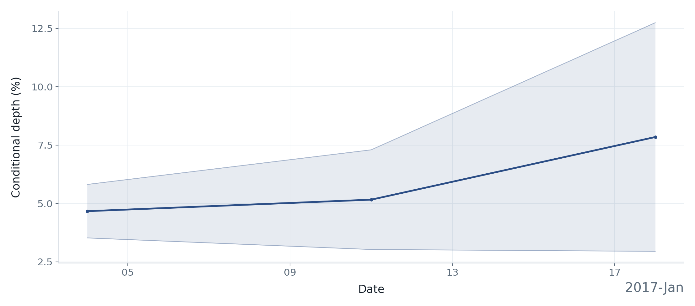

# Examples

These listings are **documentation**. After
[installing `crashfrontier`](../getting-started/install.md), copy a block
into any local file and run it. You do not need the repository.

Sample figures below (except the synthetic first panel) were computed on an
OptionMetrics SPX extract; the package does not ship those quotes, so point
the scripts at your own data to reproduce them. See
[Market data](../getting-started/data.md).

Default `QuoteFilter` still keeps `volume >= 1` when a volume column is
present. In tables and `scenario_check`, `prob` / `loss` / `depth` are
decimals. On the figures, probability and depth are percents and loss is
basis points (bp). 1 basis point = 0.01 percentage points = 0.0001;
100 bp = 1%. Default loss axes spell out “basis points”.

---

## Figure gallery

The first panel is generated by the self-contained synthetic example below.

<div class="cf-example-gallery">
  <a class="cf-example-card" href="#synthetic-risk-neutral">
    
    <span class="cf-example-card__copy">
      <strong>Synthetic first frontier</strong>
      <small>Generated by the complete code below; no vendor data required.</small>
    </span>
  </a>
  <a class="cf-example-card" href="#nested-quote-sets">
    
    <span class="cf-example-card__copy">
      <strong>Nested quote sets</strong>
      <small>2017-07-05 → 2017-07-19, 14 days.</small>
    </span>
  </a>
  <a class="cf-example-card" href="#physical-gamma">
    
    <span class="cf-example-card__copy">
      <strong>Physical γ=2</strong>
      <small>2020-03-25 → 2020-04-24, 30-day PM, B=5.</small>
    </span>
  </a>
  <a class="cf-example-card" href="#nested-quote-sets">
    
    <span class="cf-example-card__copy">
      <strong>Full report</strong>
      <small>Same 2017-07-05 14-day nest.</small>
    </span>
  </a>
  <a class="cf-example-card" href="#term-threshold-series">
    
    <span class="cf-example-card__copy">
      <strong>Threshold profile</strong>
      <small>2017-07-05, 14 days, four values of K.</small>
    </span>
  </a>
  <a class="cf-example-card" href="#term-threshold-series">
    
    <span class="cf-example-card__copy">
      <strong>Time series</strong>
      <small>Weekly, 2017-01-04 to 2017-01-18, about 30 days.</small>
    </span>
  </a>
</div>

---

## Synthetic risk-neutral example {#synthetic-risk-neutral}

Self-contained γ=0 run: a discrete risk-neutral law for \(X=S_T/F\) with
\(\mathbb{E}[X]=1\), put bid/ask from that law, then
`CrossSection.from_quotes` → `compute_frontier` → `plot_frontier_panels` /
`save_figure` / `write_frontier`. No `DATA/`, no `tests/`, no repository.

The support points and weights are symmetric around 1, so the mean is 1 by construction.
Strikes sit in the default put-wing log-moneyness window
\([-0.35,0.05]\). Calendar spacing is 14 days (inside the default
\([7,120]\) day filter). Forward \(F=1\) and \(r=0\) so put prices equal
\(\mathbb{E}[(k-X)_+]\).

Save as `synthetic_frontier.py` and run `python synthetic_frontier.py`.

```python
from pathlib import Path

import matplotlib

matplotlib.use("Agg")

import matplotlib.pyplot as plt
import numpy as np
import pandas as pd

from crashfrontier import (
    CrossSection,
    compute_frontier,
    plot_frontier_panels,
    save_figure,
    write_frontier,
)

atoms = np.array([0.60, 0.75, 0.88, 1.00, 1.12, 1.25, 1.40])
mass = np.array([0.05, 0.10, 0.15, 0.40, 0.15, 0.10, 0.05])
assert np.isclose(mass.sum(), 1.0)
assert np.isclose(float(mass @ atoms), 1.0)

strikes = np.round(np.linspace(0.71, 1.05, 18), 4)
mid = np.array([float(np.sum(mass * np.maximum(k - atoms, 0.0))) for k in strikes])
half = 0.001 + 0.04 * mid
quotes = pd.DataFrame(
    {
        "strike": strikes,
        "cp_flag": "P",
        "bid": np.maximum(mid - half, 0.0),
        "ask": mid + half,
        "volume": 10,
    }
)

cs = CrossSection.from_quotes(
    quotes,
    date="2024-01-17",
    expiry="2024-01-31",
    forward=1.0,
    rate=0.0,
)
print(cs.summary())

frontier = compute_frontier(cs, K=0.90)
print(frontier.describe())

out = Path("outputs/synthetic_frontier")
fig = plot_frontier_panels(frontier)
written = save_figure(fig, out)
plt.close(fig)
written.extend(write_frontier(frontier, out))
for path in written:
    print("wrote", path)
```

**Terminal output**

```text
{'date': Timestamp('2024-01-17 00:00:00'), 'expiry': Timestamp('2024-01-31 00:00:00'), 'am_settlement': 0, 'root': '', 'days': 14, 'tau': 0.038356164383561646, 'forward': 1.0, 'forward_source': 'user', 'rate': 0.0, 'rate_source': 'user', 'discount': 1.0, 'spot': nan, 'n_quotes': 18, 'n_puts': 18, 'n_calls': 0, 'n_put_strikes': 18, 'n_call_strikes': 0, 'ambiguous_settlement': False}
2024-01-17 → 2024-01-31 (14d)  K=0.90  γ=0
quote_set=put_wing  n_quotes=18  n_strikes=18
F=1 (user)  D=1  support_cap=none
mode=hard  method=hull  status=edges_certified  dimension=2
prob=[0.1402, 0.373]  loss=[0.02983, 0.03532]  depth=[0.0799732, 0.212767]
area=0.00349424  area_outer=0.00349424  area_ratio=0.650453  interior_ok=True  interior_margin=0.5
wrote outputs/synthetic_frontier.pdf
wrote outputs/synthetic_frontier.png
wrote outputs/synthetic_frontier_summary.csv
wrote outputs/synthetic_frontier_vertices.csv
wrote outputs/synthetic_frontier_halfplanes.csv
wrote outputs/synthetic_frontier_quotes.csv
wrote outputs/synthetic_frontier.json
```

<figure class="cf-example-figure">
  
  <figcaption>
    Generated by the code above.
  </figcaption>
</figure>

`compute_frontier(cs, K=0.90)` is γ=0, `quote_set="put_wing"`, unbounded
support. `save_figure` writes PNG/PDF; `write_frontier` writes
`_summary.csv`, `_vertices.csv`, `_halfplanes.csv`, `_quotes.csv`, and
`.json` next to the same stem. Pass the stem without an extension;
`save_figure` adds `.png` / `.pdf` itself.

Column mapping and `strike_scale` for real tables:
[`CrossSection.from_quotes`](../data-guide/from-quotes.md). How to read the
panels: [First crash frontier](../getting-started/first-frontier.md) and
[Risk-neutral frontier](../user-guide/risk-neutral.md).

---

## Your own quote directory {#your-directory}

Point `CRASHFRONTIER_DATA` at a folder you already have. Take dates from
the files rather than hard-coding a calendar.

```python
import os
from pathlib import Path

from crashfrontier import Dataset, compute_frontier

DATA_ROOT = Path(os.environ["CRASHFRONTIER_DATA"])
ds = Dataset.from_directory(DATA_ROOT)
print(ds.describe())

dates = ds.available_dates()
print(dates[0].date(), dates[-1].date(), "n_dates", len(dates))

date = dates[-1]
print(ds.expiries(date).to_string(index=False))

cs = ds.cross_section(date, target_days=30)
print(cs.summary())

frontier = compute_frontier(cs, K=0.90)
print(frontier.describe())
```

`cross_section` needs one of `expiry`, `days`, or `target_days`. Inspect
`expiries` before pinning a contract; AM and PM are never merged. If the
last date has no ~30-day expiry, pick another row from `dates` or pass
`expiry=` / `days=`. `nearest_date` snaps a target onto the calendar.

Reuse the `plot_frontier_panels` / `save_figure` / `write_frontier` pattern
from the synthetic listing. Directory layout, IvyDB `strike_price` ×1000,
and `cache_dir`: [Market data](../getting-started/data.md) and
[Read from a directory](../data-guide/from-directory.md). Expiry selection:
[Select a cross-section](../user-guide/select-cross-section.md).

---

## Other calls

The figures below were computed on OptionMetrics SPX slices. Set
`CRASHFRONTIER_DATA` to a directory that contains the stated date, or
replace the date with one from `available_dates()`.

### Physical γ=1 and γ=2 {#physical-gamma}

At γ>0 the default quote set is `full_otm`, which is often infeasible.
Pass `put_wing` and a finite support cap. Axis labels are \(q_{\gamma,K}\)
and \(\ell_{\gamma,K}\). `depth_lo` / `depth_hi` may be missing when the
endpoints are not certified; the joint set can still be used.

The sample is **2020-03-25, exactly 30 calendar days, PM settlement**.

```python
import os
from pathlib import Path

from crashfrontier import Dataset, compute_frontier

ds = Dataset.from_directory(Path(os.environ["CRASHFRONTIER_DATA"]))
cs = ds.cross_section("2020-03-25", days=30, am_settlement=0)
g1 = compute_frontier(cs, 0.90, gamma=1, quote_set="put_wing", support_cap=5.0)
g2 = compute_frontier(cs, 0.90, gamma=2, quote_set="put_wing", support_cap=5.0)
print(g1.describe())
print(g2.describe())
```

**Sample output** on that slice

| Model | Crash probability | Expected loss | Conditional depth |
|---|---:|---:|---:|
| γ=1, put wing, \(B=5\) | 14.2%–24.3% | 194–250 bp | 7.97%–16.9% |
| γ=2, put wing, \(B=5\) | 8.00%–19.4% | 110–171 bp | 7.21%–15.9% |

<div class="cf-example-gallery cf-example-gallery--two">
  <figure class="cf-example-figure">
    
    <figcaption>2020-03-25 → 2020-04-24 (30-day PM), γ=1, put wing, \(B=5\).</figcaption>
  </figure>
  <figure class="cf-example-figure">
    
    <figcaption>Same 2020-03-25 30-day PM cross-section, γ=2, put wing, \(B=5\).</figcaption>
  </figure>
</div>

Full walk-through: [Physical frontier](../user-guide/physical.md).

### Nested quote sets {#nested-quote-sets}

Each later layer should sit inside the previous one. At γ=0 the names are
`put_pair`, `local_eight`, and `put_wing`. The sample is **2017-07-05,
target 14 days, window (7, 21)**.

```python
import os
from pathlib import Path

from crashfrontier import (
    Dataset,
    binding_quotes,
    nested_frontiers,
    plot_frontier_panels,
    plot_report,
)

ds = Dataset.from_directory(Path(os.environ["CRASHFRONTIER_DATA"]))
cs = ds.cross_section("2017-07-05", target_days=14, window=(7, 21))
fronts = nested_frontiers(
    cs,
    0.90,
    gamma=0,
    sets=("put_pair", "local_eight", "put_wing"),
)
for name, layer in fronts.items():
    print(name)
    print(layer.describe())

fig = plot_frontier_panels(fronts)
certificate = binding_quotes(cs, 0.90, direction=(1.0, 0.0))
report = plot_report(cs, fronts, certificate=certificate)
```

**Example output**

<div class="cf-example-gallery cf-example-gallery--two">
  <figure class="cf-example-figure">
    
    <figcaption>2017-07-05 → 2017-07-19 (14 days), K=0.90, γ=0.</figcaption>
  </figure>
  <figure class="cf-example-figure">
    
    <figcaption>Same 2017-07-05 14-day nest: quotes, joint set, depth, and the γ=0 dual certificate.</figcaption>
  </figure>
</div>

`write_frontier(fronts, stem)` writes one stacked table per file;
`write_frontier(..., certificate=certificate)` adds `_binding.csv`.
Details: [Quote sets](../user-guide/quote-sets.md) and
[Reports](../user-guide/reports.md).

### Scenario check {#scenario-check}

Inputs are table decimals, not figure percents or basis points.
`geometry` is `inside`, `outside`, or `boundary`. The numbers below are the
same **2017-07-05, 14-day, γ=0 put wing**.

```python
import os
from pathlib import Path

from crashfrontier import Dataset, compute_frontier, portfolio_bound, scenario_check

ds = Dataset.from_directory(Path(os.environ["CRASHFRONTIER_DATA"]))
cs = ds.cross_section("2017-07-05", target_days=14, window=(7, 21))
frontier = compute_frontier(cs, 0.90)
inner = frontier.vertices()
inner = inner.loc[inner["kind"].eq("inner")]
inside = scenario_check(
    cs,
    0.90,
    float(inner["prob"].mean()),
    float(inner["loss"].mean()),
    quote_set="put_wing",
)
print(inside["feasible"], inside["geometry"], inside["method"])

outside = scenario_check(cs, 0.90, 0.9, 0.5, quote_set="put_wing")
print(outside["feasible"], outside["geometry"])

lo, hi = portfolio_bound(cs, 0.90, 1.0, 0.0, quote_set="put_wing")
print("portfolio_bound 1{X<=K}", lo, hi)
```

**Sample output**

```text
True inside lp
False outside lp
portfolio_bound 1{X<=K} 0.0006565 0.0069257
```

<figure class="cf-example-figure">
  
  <figcaption>
    2017-07-05 → 2017-07-19 (14 days), K=0.90, γ=0 put wing.
    `scenario_check` returns a dictionary.
  </figcaption>
</figure>

[Scenario check](../user-guide/scenario.md).

### Term structure, threshold profile, time series {#term-threshold-series}

Failed tenors or dates stay in the table with an `error` string and drop
out of the figure. Term-structure *x* is actual `days`, not
`target_days`.

The term-structure figure is **2017-07-05**, γ=0, K=0.90, target tenors
7, 14, and 30. The threshold figure uses the **14-day** cross-section on
that date. The time-series figures are weekly from **2017-01-04 through
2017-01-18**, target about 30 days, window (20, 45).

```python
import os
from pathlib import Path

from crashfrontier import (
    Dataset,
    frontier_series,
    plot_term_structure,
    plot_threshold_profile,
    plot_time_series,
    term_structure,
    threshold_profile,
)

ds = Dataset.from_directory(Path(os.environ["CRASHFRONTIER_DATA"]))
tenor_table, tenor_fronts = term_structure(
    ds, "2017-07-05", tenors=(7, 14, 30), K=0.90, gamma=0
)
print(tenor_table.to_string(index=False))
fig_tenor = plot_term_structure(tenor_table)

cs = ds.cross_section("2017-07-05", target_days=14, window=(7, 21))
thr_table, thr_fronts = threshold_profile(
    cs, (0.80, 0.85, 0.90, 0.95), gamma=0
)
print(thr_table.to_string(index=False))
fig_thr = plot_threshold_profile(thr_table)

series = frontier_series(
    ds,
    start="2017-01-01",
    end="2017-01-18",
    freq="W",
    K=0.90,
    gamma=0,
    target_days=30,
    window=(20, 45),
    snap="backward",
    workers=1,
    on_error="skip",
)
print(series.to_string(index=False))
fig_prob = plot_time_series(series, value="prob")
```

**Sample output**

<div class="cf-example-gallery">
  <figure class="cf-example-figure">
    
    <figcaption>2017-07-05, γ=0, K=0.90, target tenors 7, 14, and 30 days.</figcaption>
  </figure>
  <figure class="cf-example-figure">
    
    <figcaption>2017-07-05, 14-day cross-section, γ=0, K from 0.80 to 0.95.</figcaption>
  </figure>
  <figure class="cf-example-figure">
    
    <figcaption>Weekly probability, 2017-01-04 to 2017-01-18, γ=0, K=0.90, about 30 days.</figcaption>
  </figure>
  <figure class="cf-example-figure">
    
    <figcaption>Expected loss on the same 2017-01-04–2017-01-18 weekly sample.</figcaption>
  </figure>
  <figure class="cf-example-figure">
    
    <figcaption>Conditional depth on the same 2017-01-04–2017-01-18 weekly sample.</figcaption>
  </figure>
</div>

Pass a shorter `start`/`end` while testing. Leave `am_settlement` unset
unless the research question is one settlement session.

[Term structure](../user-guide/term-structure.md) ·
[Threshold profile](../user-guide/threshold-profile.md) ·
[Time series](../user-guide/time-series.md). Export and units:
[Results and export](../user-guide/results-export.md).
