<section class="cf-sheet">
  <div class="cf-sheet__copy">
    <p class="cf-eyebrow">Crash Frontier · Python</p>
    <h1>How likely.<br>How deep.</h1>
    <p class="cf-lead">
      Option-implied bounds on crash probability and expected loss, with the
      conditional depth of every admissible crash scenario — from one joint
      constraint set, since separate marginal bounds can pair values that no
      single distribution supports.
    </p>
    <div class="cf-actions">
      <a class="md-button md-button--primary" href="getting-started/first-frontier.html">First figure</a>
      <a class="md-button" href="getting-started/data.html">Market data</a>
    </div>
  </div>
  <figure class="cf-sheet__figure">
    
  </figure>
  <dl class="cf-facts">
    <div>
      <dt>γ = 0</dt>
      <dd>Risk-neutral LP</dd>
    </div>
    <div>
      <dt>γ = 1, 2</dt>
      <dd>Physical SOCP</dd>
    </div>
    <div>
      <dt>Input</dt>
      <dd>Your option quotes</dd>
    </div>
    <div>
      <dt>Export</dt>
      <dd>CSV · JSON · PNG · PDF</dd>
    </div>
  </dl>
</section>

## Start here

The first example generates valid put bid-ask quotes from a small synthetic
risk-neutral distribution and runs the complete plotting and export workflow —
from raw quotes to the frontier figure.

```bash
python -m pip install "git+https://github.com/Michaelzh6552/crashfrontier.git"
```

Then follow [First figure](getting-started/first-frontier.md).

## What the result contains

<div class="cf-notation">
  <article class="cf-notation__row">
    <p class="cf-metric-symbol">p</p>
    <h3>Crash probability</h3>
    <p>The admissible probability that the expiry value is at or below \(K\).</p>
  </article>
  <article class="cf-notation__row">
    <p class="cf-metric-symbol">L</p>
    <h3>Expected loss</h3>
    <p>The unconditional expected shortfall at or below the threshold.</p>
  </article>
  <article class="cf-notation__row">
    <p class="cf-metric-symbol">s = L / p</p>
    <h3>Conditional depth</h3>
    <p>The average shortfall given that the crash event occurs.</p>
  </article>
</div>

## Choose a task

<nav class="cf-index" aria-label="Choose a task">
  <a class="cf-index__item" href="getting-started/install.html">
    <span class="cf-index__num">01</span>
    <span class="cf-index__copy"><strong>Install</strong><small>Package and optional format or solver dependencies.</small></span>
  </a>
  <a class="cf-index__item" href="getting-started/data.html">
    <span class="cf-index__num">02</span>
    <span class="cf-index__copy"><strong>Market data</strong><small>Load a directory, DataFrames, or one cross-section.</small></span>
  </a>
  <a class="cf-index__item" href="getting-started/read-the-chart.html">
    <span class="cf-index__num">03</span>
    <span class="cf-index__copy"><strong>Read the figure</strong><small>Units, inner and outer sets, and conditional depth.</small></span>
  </a>
  <a class="cf-index__item" href="user-guide/physical.html">
    <span class="cf-index__num">04</span>
    <span class="cf-index__copy"><strong>Physical measure</strong><small>Use the γ=1 or γ=2 power-utility pricing kernel.</small></span>
  </a>
  <a class="cf-index__item" href="examples/index.html">
    <span class="cf-index__num">05</span>
    <span class="cf-index__copy"><strong>Examples</strong><small>Run complete scripts or adapt the data templates.</small></span>
  </a>
  <a class="cf-index__item" href="developer-guide/index.html">
    <span class="cf-index__num">06</span>
    <span class="cf-index__copy"><strong>Methods</strong><small>Data pipeline, LP/SOCP programs, and reconstruction.</small></span>
  </a>
</nav>

## Papers

The package implements the methods developed in:

<div class="cf-papers">
  <a class="cf-paper" href="https://arxiv.org/abs/2607.25353">
    <span class="cf-paper__badge">arXiv:2607.25353</span>
    <strong>The Risk-Neutral Crash Frontier</strong>
    <span class="cf-paper__sub">Sharp Joint Bounds on Crash Probability and Conditional Depth from Option Bid-Ask Quotes</span>
    <span class="cf-paper__meta">Jirong Zhuang</span>
  </a>
  <a class="cf-paper" href="https://arxiv.org/abs/2608.23274">
    <span class="cf-paper__badge">arXiv:2608.23274</span>
    <strong>The Physical Crash Frontier</strong>
    <span class="cf-paper__sub">What Finite Option Quotes Can and Cannot Reveal</span>
    <span class="cf-paper__meta">Jirong Zhuang</span>
  </a>
</div>

BibTeX and plain-text citations: [Papers](reference/papers.md).
