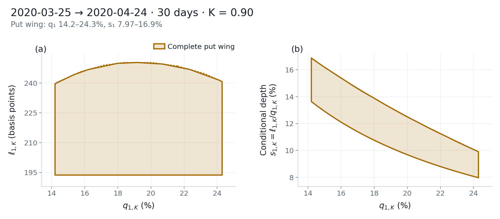
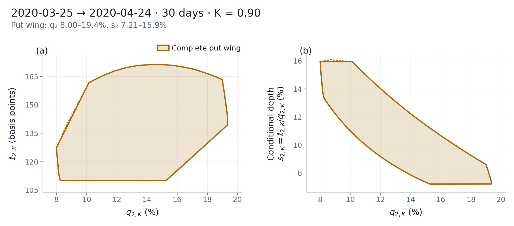

# Physical frontier (γ = 1 and γ = 2)

\(\gamma=1,2\) map the risk-neutral measure to a physical measure with the power-utility kernel \(X^\gamma/\mathbb{E}_{\mathbb{Q}}[X^\gamma]\). The script below computes both physical frontiers on the **2020-03-25, 30-day, PM-settlement** cross-section, with `put_wing` and `support_cap=5`.

## Run

Point `CRASHFRONTIER_DATA` at your quote directory. See [Market data](../getting-started/data.md).

The dates in the listing are sample dates. They must exist in that folder; otherwise pick a date from `ds.available_dates()`. Cone programs are slower than the risk-neutral LP.

Save as `physical.py`.

```python
import os
from pathlib import Path

import matplotlib

matplotlib.use("Agg")

import numpy as np

from crashfrontier import Dataset, compute_frontier, nested_frontiers, plot_frontier_panels, save_figure, write_frontier
from crashfrontier.errors import InfeasibleCrossSectionError


def show(title: str, frontier) -> None:
    print(f"\n===== {title} =====")
    print(frontier.describe())
    print(
        "depth finite?",
        np.isfinite(frontier.depth_lo),
        np.isfinite(frontier.depth_hi),
        "depth_lo",
        frontier.depth_lo,
        "depth_hi",
        frontier.depth_hi,
    )


def main() -> None:
    output = Path("outputs/user-guide/physical")
    ds = Dataset.from_directory(Path(os.environ["CRASHFRONTIER_DATA"]))

    print(ds.expiries("2020-03-25").loc[lambda t: t["days"].eq(30)].to_string(index=False))
    cs = ds.cross_section("2020-03-25", days=30, am_settlement=0)
    print(cs.summary())

    gamma1 = compute_frontier(
        cs, K=0.90, gamma=1, quote_set="put_wing", support_cap=5.0
    )
    gamma2 = compute_frontier(
        cs, K=0.90, gamma=2, quote_set="put_wing", support_cap=5.0
    )
    show("gamma=1 put_wing B=5", gamma1)
    show("gamma=2 put_wing B=5", gamma2)

    print("\n===== default full_otm (do not use for figures) =====")
    try:
        compute_frontier(cs, K=0.90, gamma=2)
    except InfeasibleCrossSectionError as exc:
        print("quote_set", exc.quote_set, "gamma", exc.gamma, "support_cap", exc.support_cap)
        print(exc)

    nested = nested_frontiers(
        cs,
        K=0.90,
        gamma=2,
        sets=("put_pair", "local_eight", "put_wing"),
        support_cap=5.0,
    )
    for name, frontier in nested.items():
        s = frontier.summary()
        print(
            name,
            "n_quotes",
            s["n_quotes"],
            "status",
            s["status"],
            "prob",
            (s["prob_lo"], s["prob_hi"]),
            "depth",
            (s["depth_lo"], s["depth_hi"]),
        )

    save_figure(plot_frontier_panels(gamma2), output / "gamma2", formats=("png", "pdf"))
    save_figure(plot_frontier_panels(nested), output / "gamma2_nested", formats=("png", "pdf"))
    write_frontier(gamma1, output / "gamma1", formats=("csv", "json"))
    write_frontier(gamma2, output / "gamma2", formats=("csv", "json"))
    write_frontier(nested, output / "gamma2_nested", formats=("csv", "json"))


if __name__ == "__main__":
    main()
```

## How to read the result

### Pin the slice and the quote set

The physical example is fixed at:

- Observation date `2020-03-25`
- `days=30` and `am_settlement=0` (expiry `2020-04-24`, PM / SPXW)
- `K=0.90`
- `quote_set="put_wing"`
- `support_cap=5.0`

Pin `days` and `am_settlement` so the selector does not land on the SPX morning session.

On this slice, `F=2477.300494`, `rate=0.0` (the series is 0 that day), 413 quotes enter the cross-section, and the default volume filter drops 265 rows.

| \(\gamma\) | Program | Default quote set | Default \(B\) | Usage here |
|---|---|---|---|---|
| 0 | LP | `put_wing` | unbounded | 2017 slice |
| 1 | SOCP | **`full_otm`** | 5 | **`put_wing` + 5** |
| 2 | SOCP | **`full_otm`** | 5 | **`put_wing` + 5** |

`compute_frontier(cs, K=0.90, gamma=2)` **does not** switch to the put wing by itself. On 2020-03-25, default `full_otm` + \(B=5\) raises `InfeasibleCrossSectionError` with `quote_set='full_otm'`, `support_cap=5.0`, and `status='infeasible'`. The message mentions retrying `put_wing` or `support_cap=None`; **neither is guaranteed to restore feasibility**.

\(\gamma=1,2\) have **no** minimum-slack fallback of the risk-neutral kind. Infeasible means there is no feasible measure.

### Sample intervals

Do not compare magnitudes with the 2017 \(p_K,L_K\). Axis labels are \(q_{\gamma,K}\) and \(\ell_{\gamma,K}\).

| Setting | n_quotes | Probability | Loss | Depth | status |
|---|---:|---|---|---|---|
| \(\gamma=1\) put_wing \(B=5\) | 85 | 14.2%–24.3% | 194–250 bp | 7.97%–16.9% | `converged` |
| \(\gamma=2\) put_wing \(B=5\) | 85 | 8.00%–19.4% | 110–171 bp | 7.21%–15.9% | `converged` |

Both are `mode=socp`, `method=grid`, `dimension=2`. `solver_gap` here is the largest cone-constraint violation, not an LP dual gap. Larger \(\gamma\) pushes mass from low \(X\) toward high \(X\), so physical crash probability is usually below the risk-neutral value; at \(\gamma=1\) the denominator is already pinned by the forward (\(\mathbb{E}[X]=1\)).

<div class="cf-example-gallery cf-example-gallery--two">
  <figure class="cf-example-figure">
    
    <figcaption>2020-03-25 → 2020-04-24 (30-day PM), γ=1, put wing, \(B=5\). Supply this cross-section yourself.</figcaption>
  </figure>
  <figure class="cf-example-figure">
    
    <figcaption>Same 2020-03-25 30-day PM cross-section, γ=2, put wing, \(B=5\).</figcaption>
  </figure>
</div>

### Depth endpoints and numerical reconciliation

At \(\gamma>0\), `depth_lo` / `depth_hi` start from a **separate** cone
program. The package cross-checks those endpoints against \(L/p\) on the
reconstructed inner polygon. A small solver discrepancy is handled
conservatively by widening the public interval; inspect
`diagnostics["solver_depth_lo/hi"]`,
`diagnostics["inner_depth_lo/hi"]`, and
`diagnostics["depth_reconciled"]`.

If the reconstructed inner range extends beyond the solver range by more
than `5e-3`, `diagnostics["depth_enclosure_ok"]` is `False` and the public
endpoints are NaN. A wider solver range that contains the inner range is
valid. Endpoints also remain NaN when crash-probability mass is too small or
no usable depth solve is available. The joint set (`prob`/`loss` inner/outer)
can still be complete. `plot_conditional_depth` samples the inner boundary,
so its shape is a geometric diagnostic rather than a replacement for missing
endpoints.

Check whether the joint set is complete. If needed, install `crashfrontier[solvers]` and recompute under **the same specification**. If the values remain NaN, write “conditional-depth endpoints uncertified” in the report rather than changing `quote_set`.

### Nested calls must pass `sets`

`nested_frontiers(..., gamma=2)` defaults to `sets=("put_pair", "local_eight", "put_wing", "full_otm")`. Failure at `full_otm` raises for the whole call: `nested_frontiers failed at quote_set='full_otm' (completed: ...)`. The first three layers are not plotted on their own. When the research specification uses only the put wing, pin the first three layers.

At \(\gamma>0\), `accumulate_halfplanes` defaults to True: each later layer's outer outline is intersected with the supporting halfplanes of the earlier layers.

`support_cap=None` removes the right-tail upper bound. At \(\gamma=2\), an unbounded right tail can raise \(\mathbb{E}[X^2]\) and push the lower bounds on physical crash probability and loss toward 0. That is a different tail assumption, not a switch for making `full_otm` produce a figure.

The script writes `outputs/user-guide/physical/gamma2.png` / `.pdf`, `gamma2_nested.png` / `.pdf`, and CSV/JSON for `gamma1_*` / `gamma2_*` / `gamma2_nested_*`. The default `full_otm` block should print `InfeasibleCrossSectionError`.

## Options

| Task | Call |
|---|---|
| \(\gamma=1\) only | Drop the `gamma2` line |
| Nested \(\gamma=1\) | `nested_frontiers(cs, 0.90, gamma=1, sets=("put_pair", "local_eight", "put_wing"), support_cap=5.0)` |
| Other \(B\) | `support_cap=4.0` or `None` (another tail assumption) |
| Coarser grid (faster, looser) | `grid_settings=GridSettings(levels=(16, 32), max_normalized_gap=0.05)` |
| Fallback solvers | `python -m pip install 'crashfrontier[solvers]'`; CLARABEL is still tried first |

## Common errors

- **Changing only `gamma` and leaving the default quote set.** Default `full_otm` is infeasible on this slice.
- **Physical nesting without `sets`.** The fourth layer `full_otm` fails the entire call.
- **Using 2017-07-05 for the `gamma2` figure.** The physical listing on this page uses 2020-03-25.
- **Comparing the size of \(p_K\) with \(q_{2,K}\) as if one probability had changed.** The measures differ.
- **Treating `interior_margin does not hold` as failure.** The physical model continues; read the final `status` and the intervals.
- **Switching to `full_otm` or turning off the filter when depth is NaN.** Report the uncertified endpoints; do not change the research specification to fill in a number.
- **`portfolio_bound` / `binding_quotes`.** Both raise immediately when \(\gamma\neq 0\).
