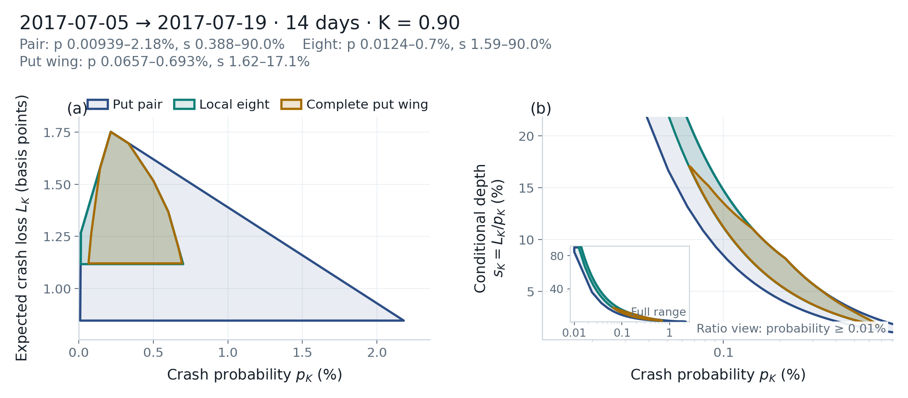

# Quote sets: put_pair / local_eight / put_wing / full_otm

The quote set chooses which bid–ask prices enter the program, and therefore which identification problem is solved. The script below compares `put_pair`, `local_eight`, and `put_wing` on the same cross-section, and documents `full_otm` in the physical model.

## Run

Point `CRASHFRONTIER_DATA` at your quote directory. See [Market data](../getting-started/data.md).

The dates in the listing are sample dates. They must exist in that folder; otherwise pick a date from `ds.available_dates()`.

Save as `quote_sets.py` and run `python quote_sets.py`.

```python
import os
from pathlib import Path

import matplotlib

matplotlib.use("Agg")

from crashfrontier import Dataset, compute_frontier, nested_frontiers, plot_frontier_panels, save_figure, write_frontier
from crashfrontier.data.quote_sets import nested_quote_sets, select_quote_set
from crashfrontier.errors import InfeasibleCrossSectionError


def sizes(quotes, K: float, design: str) -> dict[str, tuple[int, int]]:
    sets = nested_quote_sets(quotes, K, design)
    sets["full_panel"] = select_quote_set(quotes, K, "full_panel", design)
    return {
        name: (len(frame), int(frame["strike"].nunique()) if len(frame) else 0)
        for name, frame in sets.items()
    }


def main() -> None:
    output = Path("outputs/user-guide/quote-sets")
    ds = Dataset.from_directory(Path(os.environ["CRASHFRONTIER_DATA"]))
    cs2017 = ds.cross_section("2017-07-05", target_days=14, window=(7, 21))
    cs2020 = ds.cross_section("2020-03-25", days=30, am_settlement=0)

    print("2017 risk-neutral wing vs physical wing (quote counts only, no frontier):")
    print(" riskneutral", sizes(cs2017.quotes, 0.90, "riskneutral"))
    print(" physical   ", sizes(cs2017.quotes, 0.90, "physical"))
    print("2020")
    print(" riskneutral", sizes(cs2020.quotes, 0.90, "riskneutral"))
    print(" physical   ", sizes(cs2020.quotes, 0.90, "physical"))

    print("\n===== gamma=0 nested =====")
    rn = nested_frontiers(
        cs2017,
        K=0.90,
        gamma=0,
        sets=("put_pair", "local_eight", "put_wing"),
    )
    for name, frontier in rn.items():
        s = frontier.summary()
        print(name, "n_quotes", s["n_quotes"], "prob", (s["prob_lo"], s["prob_hi"]), "depth", (s["depth_lo"], s["depth_hi"]))

    print("\n===== gamma=0 misusing full_otm =====")
    try:
        compute_frontier(cs2017, K=0.90, quote_set="full_otm")
    except ValueError as exc:
        print(exc)

    print("\n===== gamma=2 must pass sets, else default includes full_otm =====")
    try:
        nested_frontiers(cs2020, K=0.90, gamma=2, support_cap=5.0)
    except InfeasibleCrossSectionError as exc:
        print(exc)

    phys = nested_frontiers(
        cs2020,
        K=0.90,
        gamma=2,
        sets=("put_pair", "local_eight", "put_wing"),
        support_cap=5.0,
    )
    for name, frontier in phys.items():
        s = frontier.summary()
        print(name, "n_quotes", s["n_quotes"], "status", s["status"], "depth", (s["depth_lo"], s["depth_hi"]))

    save_figure(plot_frontier_panels(rn), output / "rn_nested", formats=("png",))
    save_figure(plot_frontier_panels(phys), output / "phys_nested", formats=("png",))
    write_frontier(rn, output / "rn_nested", formats=("csv", "json"))
    write_frontier(phys, output / "phys_nested", formats=("csv", "json"))


if __name__ == "__main__":
    main()
```

## Quote-set rules

### Names and which quotes they use

| Name | Quotes used | Typical use |
|---|---|---|
| `put_pair` | Two puts around \(K\); see the design-specific rule below | Least information, largest identified set |
| `local_eight` | Nearest additional puts, at most 8 distinct \(x\) | Intermediate layer |
| `put_wing` | Put wing | Default at \(\gamma=0\); a practical starting point at \(\gamma>0\) |
| `full_otm` | Out-of-the-money puts ∪ out-of-the-money calls | Programmatic default at \(\gamma>0\); infeasible on many cross-sections |
| `full_panel` | Every call and put in the cross-section | Tightest; name it when you want it |

The wing definition depends on `design` (`compute_frontier` chooses from \(\gamma\)):

- **Risk-neutral pair**: nearest put at or below \(K\) and nearest put at or
  above \(K\). If a put lies exactly at \(K\), it is retained with the
  nearest remaining strike.
- **Physical pair**: closest retained put strictly below \(K\) and closest
  retained put strictly above \(K\). A put exactly at \(K\) is not one side
  of the pair; missing either side raises `ValueError`.
- **Risk-neutral wing**: puts with log-moneyness \(\log(x)\in[-0.35,0.05]\)
- **Physical wing**: out-of-the-money puts with \(x\le 1\) and \(\log x\ge -0.35\)
- **Physical `full_otm`**: those out-of-the-money puts, plus out-of-the-money calls with \(x\ge 1\)

On the same day and the same cross-section, `put_wing` can therefore have different row counts under the two designs.

| Cross-section | Design | put_pair | local_eight | put_wing | full_otm | full_panel |
|---|---|---:|---:|---:|---:|---:|
| 2017 14-day | risk-neutral | 2 | 8 | 54 | (no such name) | 86 |
| 2017 14-day | physical | 2 | 8 | 47 | 68 | 86 |
| 2020 30-day | risk-neutral | 2 | 8 | 99 | (no such name) | 413 |
| 2020 30-day | physical | 2 | 8 | 85 | 315 | 413 |

`select_quote_set(quotes, K, name, design)` raises `ValueError` when the name does not belong to that design, and lists the available names.

### Nested defaults

- \(\gamma=0\): `put_pair`, `local_eight`, `put_wing`
- \(\gamma>0\): those three layers **plus** `full_otm`

An infeasible layer raises `InfeasibleCrossSectionError`; the layer is not omitted. On 2020-03-25 the default physical nest fails at `full_otm` even after the first three layers have finished.

Each later layer's inner set should lie inside the previous one. When comparing nests, check whether the same column narrows monotonically across `name`. Do not mix different \(\gamma\) or different `support_cap` in one table as variants of a single frontier.

### `support_cap` and the quote set are independent

Shrinking \(B\) tightens the right tail; removing the upper bound is a different tail assumption. OTM puts and OTM calls can be physically mutually exclusive under support \([0,5]\), so `put_wing` on a cross-section can be feasible while `full_otm` is not. When a layer is infeasible, check the inputs and record the failure as a result; a different quote set or support cap is a separate research setting and should be reported as one, not used to make the solve pass.

The script writes `outputs/user-guide/quote-sets/rn_nested.png`,
`phys_nested.png`, and matching CSV / JSON. The risk-neutral put-wing
interval is the 2017-07-05, 14-day slice documented on the
[risk-neutral page](risk-neutral.md). The
[first figure](../getting-started/first-frontier.md) is the synthetic
2024-01-17 example.

<figure class="cf-example-figure">
  
  <figcaption>
    2017-07-05 → 2017-07-19 (14 days), K=0.90, γ=0. Put pair, local eight, and put wing. Quotes are not included with the package.
  </figcaption>
</figure>

## Options

| Task | Call |
|---|---|
| Two layers only | `sets=("put_pair", "put_wing")` |
| Single layer | `compute_frontier(cs, 0.90, quote_set="local_eight")` |
| Your own quote table | `compute_frontier(cs, 0.90, quote_set=my_dataframe)`; the name becomes `custom` |
| Physical nest without accumulated outer halfplanes | `nested_frontiers(..., gamma=2, accumulate_halfplanes=False)` |
| Other \(K\), then re-bracket the pair | `put_pair` re-brackets as \(K\) changes |

## Common errors

- **Writing `full_otm` at \(\gamma=0\).** `unknown quote set 'full_otm'`.
- **Expecting the default nest to skip `full_otm` on failure.** It does not skip.
- **Comparing the 2017 risk-neutral wing with the 2020 physical wing as the same specification becoming wider.** Date, wing definition, and the filtered cross-section all differ.
- **Setting `min_volume` to 0 so `full_otm` produces a figure.** The sample changed; the result is not comparable to the default filter.
