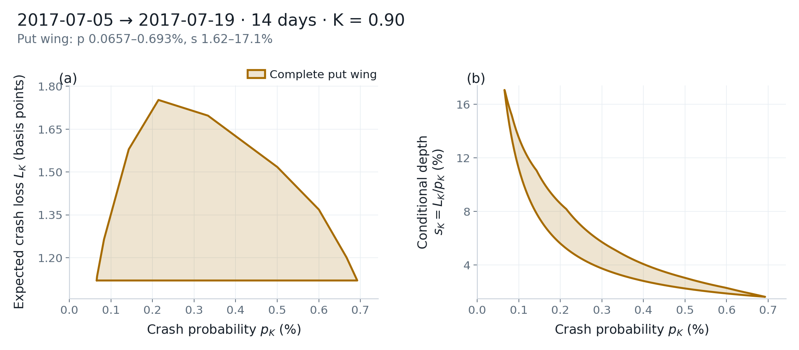

# Risk-neutral frontier (γ = 0)

\(\gamma=0\) is the crash probability and expected crash loss allowed by arbitrage-free measures \(\mathbb{Q}\) that are compatible with bid–ask quotes. The script below uses the 14-day cross-section on 2017-07-05, computes the risk-neutral put wing, and records `mode`, `method`, and `status`.

## Run

Point `CRASHFRONTIER_DATA` at your quote directory. See [Market data](../getting-started/data.md).

The dates in the listing are sample dates. They must exist in that folder; otherwise pick a date from `ds.available_dates()`.

Save as `risk_neutral.py` and run `python risk_neutral.py`.

```python
import os
from pathlib import Path

import matplotlib

matplotlib.use("Agg")

from crashfrontier import (
    Dataset,
    compute_frontier,
    plot_frontier_panels,
    save_figure,
    write_frontier,
)


def main() -> None:
    output = Path("outputs/user-guide/risk-neutral")
    ds = Dataset.from_directory(Path(os.environ["CRASHFRONTIER_DATA"]))
    cs = ds.cross_section("2017-07-05", target_days=14, window=(7, 21))

    frontier = compute_frontier(cs, K=0.90)
    print(frontier.describe())
    print()
    print("quote_set", frontier.quote_set)
    print("support_cap", frontier.support_cap)
    print("mode", frontier.mode, "method", frontier.method, "status", frontier.status)
    print("dimension", frontier.dimension)
    print("n_quotes", frontier.n_quotes, "n_strikes", frontier.n_strikes)
    print("forward_source", frontier.forward_source)
    print("interior_ok", frontier.interior_ok, "interior_margin", frontier.interior_margin)
    print("solver_gap", frontier.summary()["solver_gap"])
    print("diagnostics keys", sorted(frontier.diagnostics))

    save_figure(plot_frontier_panels(frontier), output, formats=("png", "pdf"))
    write_frontier(frontier, output, formats=("csv", "json"))
    print("wrote", output.resolve())


if __name__ == "__main__":
    main()
```

## How to read the result

### Defaults on this specification

```text
compute_frontier(cs, K=0.90)
```

is `gamma=0`, `quote_set="put_wing"`, `support_cap="auto"` (unbounded at \(\gamma=0\)), `mode="auto"`, `method="auto"` (convex hull).

The put wing takes puts with log-moneyness in \([-0.35, 0.05]\). Puts outside that window do not enter the program.

```text
2017-07-05 → 2017-07-19 (14d)  K=0.90  γ=0
quote_set=put_wing  n_quotes=54  n_strikes=54
F=2431.98 (table)  D=0.999628  support_cap=none
mode=hard  method=hull  status=edges_certified  dimension=2
prob=[0.000656508, 0.00692565]  loss=[0.00011202, 0.000175214]  depth=[0.0161747, 0.170631]
```

The cross-section has 55 puts and 54 enter the program.

<figure class="cf-example-figure">
  
  <figcaption>
    2017-07-05 → 2017-07-19 (14 days), K=0.90, γ=0 put wing. The package does not include these quotes.
  </figcaption>
</figure>

### `mode`, `method`, `status`

| Field | Meaning here |
|---|---|
| `mode=hard` | Hard no-arbitrage constraints are feasible |
| `mode=relaxed` | Hard constraints infeasible; `mode="auto"` falls back to the minimum slack budget \(\delta^*\) and emits a warning. Record this in the write-up |
| `method=hull` | Adaptive convex-hull reconstruction |
| `method=grid` | Direction grid |
| `method=degenerate` | A coordinate's marginal width is too narrow; the set collapses to a point or segment and area is 0 |
| `status=edges_certified` | Edges certified (this slice) |
| `dimension` | 2 is a planar region; 0 is a point; 1 is a segment |

`mode="hard"` does not fall back. `mode="relaxed"` or a passed `budget=` is a different identification problem.

At \(\gamma=0\), `solver_gap` is the largest LP dual gap. `interior_ok=False` means the system is no longer feasible after a further simultaneous inward shrink of bids and asks. If the unshrunk system remains feasible, the frontier is still computed. The sample above has `interior_ok=True`.

### Support cap

`support_cap="auto"`: unbounded at \(\gamma=0\), `5.0` at \(\gamma>0\). Any \(\gamma\) accepts `support_cap=None` (also the strings `"none"` / `"null"` / `"unbounded"`) for no upper bound. Passing a finite `5` here is a different right-tail assumption.

At \(\gamma>0\) a finite \(B\) must exceed \(\max(1,K)\), and a strike \(x\ge B\) with a positive call bid raises `ValueError`. Those checks are not applied at \(\gamma=0\): a finite \(B\) is only an extra LP tail constraint.

### Where depth comes from

At \(\gamma=0\), `depth_lo` / `depth_hi` are \(L/p\) on inner vertices with \(p>0\). The physical models solve a second cone program instead. `p0` (default `1e-4`) enters only the transformed area, `area_ratio`, and the near-zero crop on the conditional-depth figure. It does **not** change `inner` / `outer`, or `prob_*` / `loss_*`.

The script writes `outputs/user-guide/risk-neutral.png` / `.pdf` and the `write_frontier` tables (`_summary.csv` and the other three, plus `.json`). When `write_frontier` is given a single `Frontier`, the `name` column is that object's `quote_set` (here `put_wing`).

## Options

| Task | Call |
|---|---|
| Three nested layers | `nested_frontiers(cs, K=0.90, gamma=0)` |
| Other quote set | `compute_frontier(cs, K=0.90, quote_set="local_eight")` |
| All quotes | `quote_set="full_panel"` |
| Force hard constraints | `mode="hard"` (error if infeasible; no fallback) |
| Grid reconstruction | `method="grid"` |
| Other \(K\) | `K=0.85` |
| Custom LP tolerances | `lp_settings=LPSettings(...)` |

`quote_set` can also be a `DataFrame` you already filtered; then `Frontier.quote_set` becomes `"custom"`.

## Common errors

- **`quote_set="full_otm"`.** \(\gamma=0\) does not know that name.
- **Reporting `relaxed` results next to `hard`.** The slack budget already changed the identification problem.
- **Comparing magnitudes with the 2020 physical numbers.** Date, measure, and quote set all differ.
- **Passing `portfolio_bound` / `binding_quotes` at `gamma=1`.** Both are defined only at \(\gamma=0\) and raise `ValueError`.
- **Lowering the volume floor after infeasibility in order to produce a figure.** That is another sample. Check `cs.filter_report` and whether quotes cross first.
