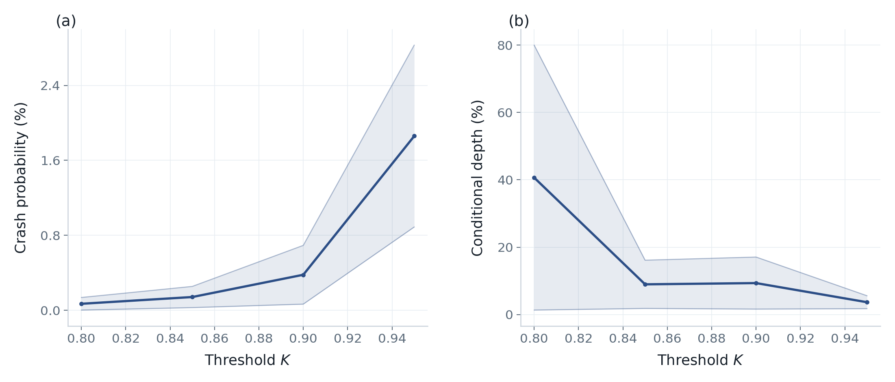

# Threshold profile: one cross-section, several K

`threshold_profile` holds the option cross-section fixed and varies the crash threshold. The script below computes the risk-neutral put wing on the 14-day cross-section of 2017-07-05 for \(K\in\{0.80,0.85,0.90,0.95\}\).

## Run

Point `CRASHFRONTIER_DATA` at your quote directory. See [Market data](../getting-started/data.md).

The dates in the listing are sample dates. They must exist in that folder; otherwise pick a date from `ds.available_dates()`.

Save as `threshold_profile_run.py` and run `python threshold_profile_run.py`.

```python
import os
from pathlib import Path

import matplotlib

matplotlib.use("Agg")

from crashfrontier import Dataset, plot_threshold_profile, save_figure, threshold_profile


def main() -> None:
    output = Path("outputs/user-guide/threshold-profile")
    ds = Dataset.from_directory(Path(os.environ["CRASHFRONTIER_DATA"]))
    cs = ds.cross_section("2017-07-05", target_days=14, window=(7, 21))
    print(cs.summary())

    table, fronts = threshold_profile(
        cs,
        thresholds=(0.80, 0.85, 0.90, 0.95),
        gamma=0,
    )
    print(table[["K", "expiry", "days", "quote_set", "n_quotes",
                 "prob_lo", "prob_hi", "depth_lo", "depth_hi", "error"]].to_string(index=False))
    print("successful thresholds:", sorted(fronts))

    csv_path = Path("outputs/user-guide/threshold-profile.csv")
    csv_path.parent.mkdir(parents=True, exist_ok=True)
    table.to_csv(csv_path, index=False)
    save_figure(plot_threshold_profile(table), output, formats=("png", "pdf"))
    print("wrote", output.resolve())


if __name__ == "__main__":
    main()
```

## How to read the result

```text
threshold_profile(cs, thresholds=(0.80, 0.85, 0.90, 0.95), *, gamma=0, **kwargs)
```

Each \(K\) calls `compute_frontier(cs, K, gamma=..., **kwargs)`. The cross-section is selected once; what changes is the event \(\{X\le K\}\). A failure is written into that row's `error` and the table continues.

\(K\) is a forward-normalized threshold, **not** an option strike in index
points. For crash events, use \(0<K<1\). The physical models enforce that
range; the risk-neutral implementation only requires a finite \(K\). If
strike scale is wrong, do not compensate by changing \(K\).

`plot_threshold_profile(table)` puts \(K\) on the horizontal axis. Larger \(K\) (shallower event) usually lifts the crash-probability band; the upper edge of the depth band cannot exceed that \(K\). At \(K=0.80\) the depth upper bound can reach 0.80 (it does in the sample below): with little information on the shallow event, conditional depth can run almost to the threshold itself.

Default `put_wing`, all four thresholds on `2017-07-19`:

| K | n_quotes | prob_lo | prob_hi | depth_lo | depth_hi |
|---:|---:|---:|---:|---:|---:|
| 0.80 | 54 | 0.000023 | 0.001364 | 0.013261 | 0.800000 |
| 0.85 | 54 | 0.000286 | 0.002545 | 0.018108 | 0.161260 |
| 0.90 | 54 | 0.000657 | 0.006926 | 0.016175 | 0.170631 |
| 0.95 | 54 | 0.008892 | 0.028305 | 0.017488 | 0.055667 |

The script writes `outputs/user-guide/threshold-profile.png` / `.pdf` and `outputs/user-guide/threshold-profile.csv`. The \(K=0.90\) row should match a single `compute_frontier(cs, 0.90)` on the same slice.

<figure class="cf-example-figure">
  
  <figcaption>
    2017-07-05, 14-day cross-section, γ=0, K in {0.80, 0.85, 0.90, 0.95}.
  </figcaption>
</figure>

## Options

| Task | Call |
|---|---|
| Denser thresholds | `thresholds=(0.80, 0.82, 0.85, 0.88, 0.90, 0.92, 0.95)` |
| Other quote set | `threshold_profile(cs, ..., quote_set="local_eight")` |
| Physical | Switch to the 2020 cross-section first, then `gamma=2, quote_set="put_wing", support_cap=5.0` |

## Common errors

- **Passing `full_otm` at \(\gamma=0\).** The name does not exist.
- **Writing \(K=90\) for “90%”.** Use `0.90`.
- **Changing the observation date together with \(K\) and calling it a threshold profile.** A profile is defined on one cross-section.
- **Treating a depth upper bound equal to \(K\) as a bug.** With few constraints that is a valid identified-set result; see \(K=0.80\).
